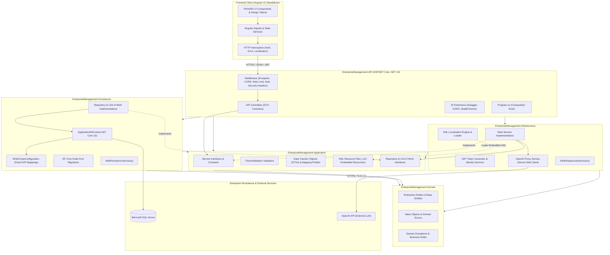
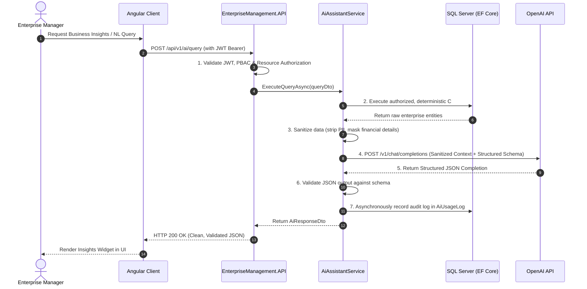

# Architecture Overview: EnterpriseManagement

**Document Version**: 1.0  
**Phase**: Phase 0 — Foundation and Architecture Planning  
**Classification**: System Architecture Specification  
**Status**: Implementation Ready  

---

## 1. Executive Architectural Blueprint

**EnterpriseManagement** is an enterprise-tier business operations platform structured according to **Clean Architecture** principles in **ASP.NET Core (.NET 10)** on the backend and a **Standalone Component Architecture in Angular 21** on the frontend.



---

## 2. Backend Clean Architecture Layers (.NET 10)

The backend is strictly organized into five decoupled projects, utilizing an **approved architectural variation** where application service contracts reside in `Application` while their concrete implementations reside in `Infrastructure`:

### 2.1 `EnterpriseManagement.Domain`
- **Core Business Layer**: Contains enterprise domain entities, base entities, value objects, domain-level enums, business rules, and domain exception types.
- **Dependencies**: Zero external NuGet packages or project dependencies (pure C# .NET 10).
- **Entities**: Includes `User`, `Role`, `Employee`, `Department`, `Project`, `TaskItem`, `Invoice`, `InvoiceItem`, `Payment`, `AuditLog`.

### 2.2 `EnterpriseManagement.Application`
- **Application Contracts & Validation Layer**: Houses service interfaces, repository contracts, DTO contracts, mapping profiles, FluentValidation validators, assembly marker `IApplicationMarker`, and XML localization resource files.
- **Dependencies**: Depends exclusively on `EnterpriseManagement.Domain`.
- **Key Artifacts**:
  - Service contracts (`IProjectService`, `IInvoiceService`, `IEmployeeService`, etc.).
  - Repository contracts (`IRepository<T>`, `IUnitOfWork`, `ICurrentUserService`).
  - Request and Response DTOs.
  - FluentValidation rules classes (`CreateInvoiceDtoValidator`, etc.).
  - Assembly Marker `IApplicationMarker` for reliable reflection and embedded resource discovery.
  - XML Localization Resource Files (`Application/Localization/Resources/EnterpriseManagement-*.xml`).
  - Application DI extension (`AddApplicationServices()`).

### 2.3 `EnterpriseManagement.Persistence`
- **Relational Persistence Layer**: Implements database persistence, EF Core configurations, migrations, and database connection lifecycle.
- **Dependencies**: Depends on `Application` and `Domain`.
- **Key Artifacts**:
  - `ApplicationDbContext` managing EF Core 10 mappings and automatic UTC timestamp handling.
  - Isolated `IEntityTypeConfiguration<TEntity>` classes for each database entity.
  - EF Core Migrations pipeline.
  - Practical repository implementations (`Repository<T>`, `UnitOfWork`).
  - Persistence DI extension (`AddPersistenceServices(IConfiguration)`).

### 2.4 `EnterpriseManagement.Infrastructure`
- **Service Implementation & Cross-Cutting Infrastructure Layer**: Implements main application services, security tokens, XML localization engine, and external integrations.
- **Dependencies**: Depends on `Application` and `Domain`.
- **Approved Architectural Variation**: In standard Clean Architecture, application services often reside inside `Application`. In this project, by approved architectural decision, main service implementations reside in `Infrastructure`, keeping `Application` purely contractual and free of implementation overhead.
- **Key Artifacts**:
  - Main service implementations (`ProjectService`, `InvoiceService`, `EmployeeService`, etc.) fulfilling application contracts.
  - JWT token generation service and authentication infrastructure.
  - Custom XML-based localization engine (`XmlResourceStringLocalizer`, `XmlResourceStringLocalizerFactory`) loading embedded XML resources from the Application assembly via `IApplicationMarker`.
  - OpenAI proxy integration client with schema validation and rate limiting.
  - Infrastructure DI extension (`AddInfrastructureServices(IConfiguration)`).

### 2.5 `EnterpriseManagement.API`
- **Presentation & Web Entry Point Layer**: Configures ASP.NET Core host, routing, HTTP middleware pipeline, modular dependency injection extensions, controllers, and composition root.
- **Dependencies**: Depends on `Application`, `Persistence`, and `Infrastructure`.
- **Key Artifacts**:
  - Thin API controllers (`BaseApiController`) returning standard `ApiResponse<T>` envelopes.
  - Global exception handling middleware converting domain/validation exceptions into standardized RFC 7807 Problem Details JSON.
  - Modular API extensions (`AddSwaggerServices()`, `AddCorsServices()`, `AddHealthCheckServices()`).
  - Standard ASP.NET Core health check endpoint mapping (`app.MapHealthChecks("/health")`) for liveness/readiness, eliminating duplicate controller wrappers.
  - Clean `Program.cs` composition root.

---

## 3. Pattern Decision: Traditional Service & Repository (NO CQRS)

### 3.1 Architectural Mandate
The system strictly enforces the **Traditional Service and Repository Pattern**. The **CQRS (Command Query Responsibility Segregation)** pattern—including MediatR, command/query dispatchers, and event sourcing—is **strictly prohibited**.

### 3.2 Repository & Unit of Work Evaluation
To avoid unnecessary abstractions while maintaining clean boundaries:
1. **Lean Repository Pattern**: Rather than an overengineered generic repository with dozens of speculative querying methods or redundant read/write repository splits, we utilize a focused `IRepository<TEntity, TId>` handling essential CRUD, primary key retrieval, and predicate queries.
2. **Explicit Unit of Work**: An `IUnitOfWork` abstraction provides explicit multi-entity transaction boundaries (`CommitAsync` / `SaveChangesAsync`) across domain operations (e.g., invoice generation paired with payment allocations or project budget decrements).
3. **Optimized Read Queries**: For complex read projections, repositories expose queryable or projected DTO methods leveraging EF Core's native `AsNoTracking()`.

---

## 4. Entity Framework Core Code-First & Schema Standards

### 4.1 Dedicated `IEntityTypeConfiguration<TEntity>` Files
Every entity in the database must have its own isolated configuration class implementing `IEntityTypeConfiguration<TEntity>`.
- **Rule**: Entity configurations must **never** be defined inside `DbContext.OnModelCreating()`.
- **Rule**: `DbContext.OnModelCreating` must call:
  ```csharp
  modelBuilder.ApplyConfigurationsFromAssembly(typeof(ApplicationDbContext).Assembly);
  ```

### 4.2 Fluent API Mapping Standards
- **Explicit Table Mapping**: `builder.ToTable("Invoices", "dbo");`
- **Primary Keys**: Explicit declaration with GUID or bigint identity: `builder.HasKey(e => e.Id);`
- **Property Constraints**:
  - Explicit string lengths: `builder.Property(e => e.InvoiceNumber).HasMaxLength(50).IsRequired();`
  - Nullability explicitly marked.
- **Decimal Precision**: Financial and rate values must define explicit precision and scale:
  ```csharp
  builder.Property(e => e.SubTotal).HasPrecision(18, 2);
  builder.Property(e => e.TotalAmount).HasPrecision(18, 2);
  builder.Property(e => e.BalanceDue).HasPrecision(18, 2);
  ```
- **Delete Behavior**: All foreign key relationships must default to `DeleteBehavior.Restrict` to safeguard against accidental cascading data loss.
- **Indexes**: Explicit index declarations for unique constraints, lookup codes, and search columns:
  ```csharp
  builder.HasIndex(e => e.InvoiceNumber).IsUnique();
  builder.HasIndex(e => e.IssueDate);
  ```

### 4.3 Environment-Driven Database Configuration & EF Core Migration Lifecycle
- **Environment-Driven Configuration**: Database connection strings are managed strictly through ASP.NET Core configuration providers (`ConnectionStrings:DefaultConnection` in `appsettings.json`, environment variables, or User Secrets). The system does not hardcode or assume a specific local database instance (e.g., LocalDB vs SQL Server Developer vs Azure SQL). Real database credentials and secrets are never committed to source control.
- **Code-First Schema Changes**: Developers modify domain entity classes and corresponding `IEntityTypeConfiguration<TEntity>` files in `EnterpriseManagement.Persistence`.
- **Migration Generation**: Migrations are generated via dotnet CLI hosted by the API startup project:
   ```bash
   dotnet ef migrations add <DescriptiveMigrationName> --project EnterpriseManagement.Persistence --startup-project EnterpriseManagement.API
   ```
- **Migration Review**: The generated migration script is inspected for breaking changes or unintended index drops.
- **Deployment Scripting**: For staging and production, idempotent SQL scripts are generated:
   ```bash
   dotnet ef migrations script --idempotent --project EnterpriseManagement.Persistence --startup-project EnterpriseManagement.API --output Database/Scripts/Deploy.sql
   ```
- **Rollback Strategy**: Migrations support clean down-migrations:
   ```bash
   dotnet ef database update <PreviousMigrationName> --project EnterpriseManagement.Persistence --startup-project EnterpriseManagement.API
   ```

---

## 5. Multilingual Support: XML-Based Resource Localization

### 5.1 ASP.NET Zero-Style XML Architecture
Instead of binary `.resx` files, localization resources are stored in structured XML files (`.xml`) conforming to the ASP.NET Zero architectural pattern:

```xml
<?xml version="1.0" encoding="utf-8" ?>
<localizationDictionary culture="en">
  <texts>
    <text name="WelcomeMessage">Welcome to EnterpriseManagement</text>
    <text name="InvoiceNotFound">The requested invoice #{0} could not be located.</text>
    <text name="Validation_RequiredField">The field '{0}' is mandatory.</text>
    <text name="PaymentExceedsBalance">Payment amount {0} exceeds the invoice balance due of {1}.</text>
  </texts>
</localizationDictionary>
```

### 5.2 Implementation Engine & Assembly Resource Loading
- **Resource Physical Directory**: Maintained inside `EnterpriseManagement.Application/Localization/Resources/`:
  - `EnterpriseManagement-en.xml` (Default Culture)
  - `EnterpriseManagement-es.xml` (Spanish)
  - `EnterpriseManagement-fr.xml` (French)
  - `EnterpriseManagement-de.xml` (German)
  - `EnterpriseManagement-ar.xml` (Arabic - RTL)
- **Assembly Resource Loading**:
  - Configured as Embedded Resources in `EnterpriseManagement.Application.csproj` (`<EmbeddedResource Include="Localization\Resources\*.xml" />`).
  - An explicit assembly marker interface `IApplicationMarker` is declared in `EnterpriseManagement.Application`. The localization engine in `EnterpriseManagement.Infrastructure` loads the XML streams directly from the Application assembly via `typeof(IApplicationMarker).Assembly.GetManifestResourceStream(...)`.
  - Embedded resource manifest names follow the deterministic format: `EnterpriseManagement.Application.Localization.Resources.EnterpriseManagement-{culture}.xml`.
  - Zero XML file duplication between projects.
- **Engine Architecture (in Infrastructure)**:
  - `XmlResourceStringLocalizer`: Implements `IStringLocalizer`. Parses XML streams into thread-safe concurrent dictionaries (`ConcurrentDictionary<string, string>`) for high-throughput lookup.
  - `XmlResourceStringLocalizerFactory`: Implements `IStringLocalizerFactory` and discovers resources from the Application assembly.
- **Request Localization Middleware Pipeline**:
  - In `Program.cs`, ASP.NET Core `app.UseRequestLocalization()` is configured with `RequestLocalizationOptions`:
    - Supported cultures: `en`, `es`, `fr`, `de`, `ar`.
    - Default request culture: `en`.
    - Request culture providers: `QueryStringRequestCultureProvider`, `CookieRequestCultureProvider`, `AcceptLanguageHeaderRequestCultureProvider`.
- **Integration**:
  - Injected into Services and Controllers via ASP.NET Core's standard `IStringLocalizer` and `IStringLocalizer<T>`.
  - FluentValidation error messages resolve localization keys dynamically based on request culture.

---

## 6. Frontend Architecture (Angular 21)

### 6.1 Modern Standalone Component Model
- **No NgModules**: Every component, directive, and pipe is declared with `standalone: true`.
- **Direct Component Imports**: Components import only the exact PrimeNG controls, Angular directives, and shared components they utilize.
- **Signals Reactivity**: Fine-grained change detection driven by Angular Signals (`signal`, `computed`, `effect`), reducing change-detection overhead.

### 6.2 Application Layering & Directory Layout
```text
Frontend/src/app/
├── core/
│   ├── auth/                      # AuthService, TokenStorage, AuthGuard, PermissionGuard
│   ├── interceptors/              # JwtInterceptor, ErrorInterceptor, LocalizationInterceptor
│   └── services/                  # ThemeService, NotificationService, SignalRHub
├── shared/
│   ├── components/                # KpiCardComponent, ConfirmModal, BreadcrumbComponent
│   ├── directives/                # HasPermissionDirective, NumberFormatDirective
│   └── pipes/                     # LocalizedCurrencyPipe, RelativeTimePipe
└── features/
    ├── auth/                      # Login, ForgotPassword, ResetPassword
    ├── dashboard/                 # ExecutiveDashboard, MetricCards, TrendCharts
    ├── projects/                  # ProjectList, ProjectDetail, MilestoneTracker
    ├── employees/                 # EmployeeDirectory, ProfileView, OrgChart
    ├── tasks/                     # TaskBoard (Kanban), TaskModal, TimeLog
    ├── invoices/                  # InvoiceList, InvoiceEditor, InvoicePdfPreview
    ├── payments/                  # PaymentList, RecordPaymentDialog
    ├── reports/                   # FinancialReport, DeliveryReport, ProductivityReport
    ├── ai-assistant/              # AiWorkspace, QueryChat, InsightCards
    └── settings/                  # OrgSettings, Preferences, AuditLogViewer
```

---

## 7. AI Business Assistant Architecture

### 7.1 Server-Side Proxy Isolation
The Angular frontend has **zero direct connectivity** to the OpenAI API. All interactions pass through `EnterpriseManagement.API` controllers:



### 7.2 Approved AI Capabilities (Strictly 3 Initial Features)
The system architecture restricts generative AI to exactly three server-side capabilities:
1. **AI Dashboard Summary**: Executive briefing synthesizing operational velocity, revenue trajectories, and active bottlenecks into a structured 3-paragraph digest.
2. **AI Business Insights**: Proactive anomaly detection highlighting overdue milestone clusters, cash-flow warning indicators, and invoice aging trends.
3. **AI Natural Language Query (NLQ)**: Conversational question-and-answer interface allowing authorized managers to ask natural language questions against pre-aggregated operational data summaries.

### 7.3 Mandatory Security & Architectural Guardrails
1. **Server-Side API Key Isolation**: OpenAI credentials reside exclusively in server-side configuration (ASP.NET Core User Secrets in development; Azure Key Vault in staging/production). Keys are never exposed to Angular, written to client files, or returned in HTTP responses.
2. **Zero Direct Database Access**: The OpenAI API is **never granted direct database access**, connection strings, or raw SQL capabilities. AI services consume only pre-aggregated, sanitized DTO context assembled by deterministic C# repository queries.
3. **Pre-Retrieval Authorization Enforcement**: The API enforces authentication (`[Authorize]`), granular PBAC claims (`AI.DashboardSummary`, `AI.BusinessInsights`, `AI.NaturalLanguageQuery`), and Resource-Level Authorization (RLA) before querying data. Context data is strictly scoped to the caller's authorized department and project boundaries.
4. **Sensitive Data Protection**: Context builders sanitize data prior to prompt formation by stripping Personally Identifiable Information (PII) and masking individual compensation and sensitive banking identifiers.
5. **Output Validation & Schema Enforcement**: All completions utilize OpenAI Structured Outputs (`response_format: { type: "json_schema" }`). Responses failing schema validation are rejected. Prompt injection defenses isolate user text within explicit XML delimiter tags.
6. **Usage Logging & Cost Audit**: Every AI invocation records an entry in the `AiUsageLog` database entity tracking `UserId`, `FeatureName`, `ModelName`, `PromptTokens`, `CompletionTokens`, `TotalTokens`, `LatencyMs`, `Timestamp`, and `EstimatedCost`.
7. **Resilient Error Handling & Graceful Degradation**: HTTP calls to OpenAI implement Polly retry policies (3 retries with exponential backoff and jitter) and circuit breakers. If OpenAI is unavailable, throttled (HTTP 429), or times out, the API gracefully degrades, returning localized user-friendly notices via `IStringLocalizer` without crashing the client UI or disrupting core operations.
8. **RAG Architecture Decision Requirement**: Retrieval-Augmented Generation (RAG) architecture, vector database selection, embedding models, document chunking, indexing pipelines, and retrieval strategies **must be evaluated and finalized during the dedicated AI Development Phase (Phase 7)**. In strict accordance with Phase 0 governance, RAG infrastructure is not implemented or selected during Phase 0.

