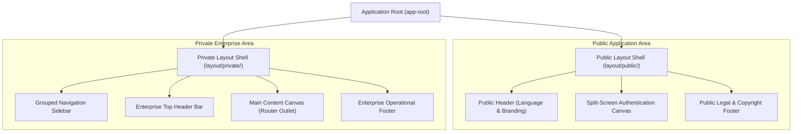
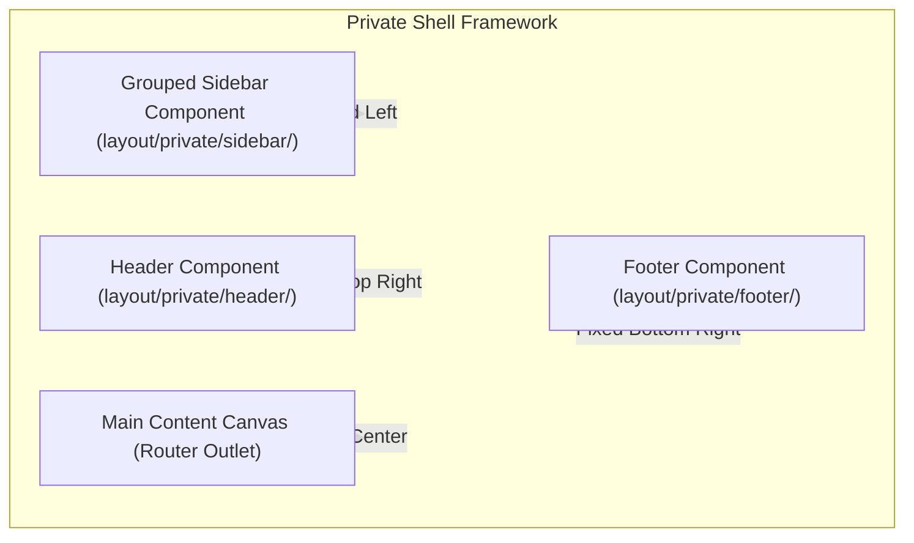

# Application Layout Blueprint: EnterpriseManagement

**Document Version:** 1.0
**Phase:** Phase 1.2 — UI/UX Design & Prototyping
**Classification:** Enterprise UI Architecture Blueprint
**Status:** Approved for Implementation Planning
**Related Documents:**
- [UI-UX-Design-Specification.md](./UI-UX-Design-Specification.md)
- [Navigation-Hierarchy.md](./Navigation-Hierarchy.md)
- [Dashboard-Wireframe-Specification.md](./Dashboard-Wireframe-Specification.md)
- [Responsive-Design-Specification.md](./Responsive-Design-Specification.md)
- [Theme-Visual-Specification.md](./Theme-Visual-Specification.md)

---

## 1. Document Purpose & Architectural Scope

This blueprint defines the structural layouts of the **EnterpriseManagement** single-organization platform. It establishes the layout geometry, zoning, component responsibilities, and responsiveness for both the **Public Layout** (pre-authentication) and **Private Layout** (post-authentication).

### Scope Boundaries
- **In Scope:** Structural layout grids, layout zoning, split-screen authentication geometry, enterprise private shell geometry, header/sidebar/footer responsibilities, and responsive view transformations.
- **Out of Scope:** Concrete Angular component implementation, route configuration code, and CSS/SCSS styling rules.

---

## 2. Global Layout Architecture

The application strictly decouples public unauthenticated views from private enterprise operational views through independent layout shells.



---

## 3. Public Layout: Split-Screen Authentication Blueprint

The Public Layout hosts authentication workflows (Login, Forgot Password, Password Reset, MFA Verification). It utilizes a modern **split-screen layout** that establishes brand prestige while maximizing ergonomic form usability.

### 3.1 Split-Screen Structural Blueprint

```text
+---------------------------------------------------------------------------------------------------+
| [Public Header]: EnterpriseManagement Logo                                  Language Selector [ES|EN] |
+-------------------------------------------------+-------------------------------------------------+
|                                                 |                                                 |
|                 BRANDING PANEL                  |            AUTHENTICATION FORM PANEL            |
|                  (Left / 50%)                   |                  (Right / 50%)                  |
|                                                 |                                                 |
|  * EnterpriseManagement Wordmark & Monogram     |  * Welcome Back Heading & Subtitle              |
|  * Executive Mission Statement:                 |  * Work Email / Username Input                  |
|    "Intelligent Operations, Fiscal Governance,  |  * Password Input with Visibility Eye Toggle    |
|     and Delivery Velocity for Modern Business"  |  * [ ] Remember Me      Forgot Password? Link   |
|  * Architectural Abstract Pattern (Teal Accent) |  * [ Sign In Button ] (Primary Teal CTA)        |
|  * Security & Compliance Seal Badges            |  * Language Selector (Secondary Placement)      |
|                                                 |  * Form Validation & Error Message Container    |
|                                                 |                                                 |
+-------------------------------------------------+-------------------------------------------------+
| [Public Footer]: © 2026 EnterpriseManagement. All Rights Reserved. | Privacy Policy | Terms of Service |
+---------------------------------------------------------------------------------------------------+
```

### 3.2 Public Layout Component Responsibilities

1. **Public Header:**
   - Positioned at the top of the viewport.
   - Minimalist presentation displaying the company identity on the left and a top-right language switcher (English `EN` / Spanish `ES`).
2. **Left Branding Panel (50% Desktop Width):**
   - High-impact brand introduction with an executive teal gradient background (`#0F766E` to `#0D9488`).
   - Displays enterprise value proposition and operational capability summary.
   - Preserves high visual contrast with crisp typography.
3. **Right Authentication Form Panel (50% Desktop Width):**
   - Centered form container with maximum width of `440px` for optimal reading and input flow.
   - Form fields:
     - `Email or Username`: Text input with leading envelope icon.
     - `Password`: Protected input with interactive show/hide toggle.
     - `Remember Me`: Checkbox preserving non-sensitive session parameters.
     - `Forgot Password`: Contextual link routing to password reset request view.
     - `Sign In`: Full-width primary teal action button.
   - State Containers:
     - Inline alert banner for authentication failures (e.g., account locked, invalid credentials).
     - Loading spinner overlay on the submit button during token negotiation.
4. **Public Footer:**
   - Minimal legal disclaimer, copyright statement, and security audit notice.

### 3.3 Public Layout Responsive Behavior
- **Desktop (`>=1200px`)**: Equal 50/50 split viewport height layout.
- **Tablet (`768px–1199px`)**: 40/60 split with condensed branding text.
- **Mobile (`<768px`)**: The left branding panel is hidden or collapsed into a compact top header banner (`80px`), giving 100% viewport width to the authentication form panel to prevent keyboard obstruction.

---

## 4. Private Layout: Enterprise Operational Shell Blueprint

The Private Layout provides the continuous operating environment for all authenticated users across the 5 approved roles and 10 approved business modules.

### 4.1 Private Layout Geometry & Blueprint

```text
+---------------------------------------------------------------------------------------------------+
| SIDEBAR (260px)  | TOP HEADER BAR (Height: 64px)                                                  |
|                  | [=] Toggle  Breadcrumbs: Dashboard / Executive Overview   [Search]  [AI] [Bell] [User] |
| Enterprise Brand +--------------------------------------------------------------------------------+
| Monogram & Title | MAIN CONTENT CANVAS (Fluid Width, Padded 24px)                                  |
|------------------|                                                                                |
| GROUPED MENU:    | Page Title & Subtitle                         [Action Button] [Date Range]     |
| > Workspace      |--------------------------------------------------------------------------------|
| > Organization   |                                                                                |
| > Projects & Work| [ Metric Card 1 ] [ Metric Card 2 ] [ Metric Card 3 ] [ Metric Card 4 ]        |
| > Finance        |                                                                                |
| > Intelligence   | [ Analytical Chart Widget (8 Cols) ]      [ AI Summary Panel (4 Cols) ]       |
| > Administration |                                                                                |
|------------------| [ Operational Data Table Widget (12 Cols) ]                                    |
| BOTTOM CONTROLS: |                                                                                |
| [Theme Toggle]   +--------------------------------------------------------------------------------+
| [User Mini-Pill] | PRIVATE FOOTER (Height: 48px): Enterprise Status: Healthy | v1.0.0             |
+---------------------------------------------------------------------------------------------------+
```

### 4.2 Private Layout Component Breakdown



#### 4.2.1 Grouped Sidebar (`layout/private/sidebar/`)
- **Width:** `260px` in expanded mode (matches runtime token `--em-layout-sidebar-width` in `_themes.scss`); `68px` in compact/collapsed rail mode (proposed design measurement; existing runtime placeholder in `_themes.scss` is `72px`); `280px` in mobile off-canvas drawer mode.
- **Top Zone:** Brand monogram, full title "EnterpriseManagement", and collapse toggle.
- **Navigation Zone:** Houses the 6 approved navigation groups and 10 modules.
- **Bottom Zone:** Quick theme switcher (`Light` / `Dark`), system status pill, and sign-out action.

#### 4.2.2 Top Header Bar (`layout/private/header/`)
- **Height:** `64px` (matches runtime token `--em-layout-header-height` in `_themes.scss`), sticky position at `top: 0`, elevated with subtle border divider.
- **Left Region:** Mobile hamburger menu trigger, contextual breadcrumb trail (`Module / Sub-view`).
- **Center Region:** Global omnibox search input (`Search projects, invoices, tasks... Ctrl+K`).
- **Right Region:**
  - AI Assistant Quick Access Icon (opens AI Natural Language Query flyout; detailed interaction is proposed functional behavior).
  - Localization Language Selector (`EN` / `ES`).
  - Notification Center Bell with red unread counter badge.
  - User Profile Avatar Pill with dropdown menu (My Profile, Preferences, Log Out).

#### 4.2.3 Main Content Canvas
- **Layout Grid:** Bootstrap 5 grid system (`container-fluid`, `row`, `col-*`) with consistent 24px (`$spacing-6` in `_variables.scss`) padding.
- **Page Header Zone:** Consistent across all screens:
  - Left: Semantic `h1` screen title and short descriptive subtitle.
  - Right: Contextual page action buttons (e.g., `+ New Project`, `Create Invoice`) and date-range pickers.
- **Dynamic Content Zone:** Renders the active feature component via Angular's standalone `<router-outlet>`.

#### 4.2.4 Private Footer (`layout/private/footer/`)
- **Height:** `44px` to `48px` (matches runtime token `--em-layout-footer-height: 48px` in `_themes.scss`), pinned to bottom of page scroll.
- **Left:** System operational status indicator (`● All Systems Operational`).
- **Right:** Application release version (`v1.0.0`), enterprise copyright, and security classification notice.

---

## 5. Responsive Layout Transformation Strategy

| Layout Zone | Desktop (`>=1200px`) | Tablet (`768px–1199px`) | Mobile (`<768px`) |
|---|---|---|---|
| **Sidebar** | Fully expanded (`260px`). Labels visible. | Compact icon-only rail (`68px`). Tooltips on hover. | Hidden off-screen. Slides in as an overlay drawer (`280px`) via hamburger trigger. |
| **Header** | Full breadcrumbs, omnibox search, all action icons (`64px` height). | Compact search icon, breadcrumbs shortened to current view (`64px` height). | Minimal header: Hamburger button, active view title, avatar icon (`64px` height). Search moves to collapsible bar. |
| **Content Canvas**| Multi-column grid (up to 4 KPI cards per row, `24px` padding). | 2-column grid for KPI cards, stacked chart widgets (`24px` padding). | 1-column vertically stacked layout with full-width cards (`16px` to `24px` padding). |
| **Data Tables** | Multi-column full tabular presentation. | Horizontal scroll wrapper with sticky frozen columns. | Card-view transformation or swipeable horizontal container. |

---

## 6. Document Status & Approvals

| Decision Area | Status | Notes |
|---|---|---|
| Split-Screen Login Architecture | **Approved** | 50/50 desktop split; branding panel collapses on mobile. |
| Grouped Sidebar Geometry | **Approved** | 260px expanded, 68px compact rail, mobile overlay drawer. |
| Top Header Specifications | **Approved** | Sticky 64px height with search, notifications, profile, language. |
| Layout Shell Implementation | *Phase 3: Frontend Foundation & Core UI Architecture* | Angular standalone layout components, grouped sidebar, header, footer, and theme switching to be implemented in Phase 3. Phase 1.2 is strictly documentation-only. |

---

## 7. Layout Measurement Classification & Governance

| Measurement Area | Dimension / Value | Governance Classification | Verification Reference / Notes |
|---|---|---|---|
| **Header Height** | `64px` | **Verified Existing Project Configuration** | Runtime token `--em-layout-header-height: 64px` in `_themes.scss`. |
| **Footer Height** | `48px` (allow `44px–48px`) | **Verified Existing Project Configuration** | Runtime token `--em-layout-footer-height: 48px` in `_themes.scss`. |
| **Expanded Sidebar Width** | `260px` | **Verified Existing Project Configuration** | Runtime token `--em-layout-sidebar-width: 260px` in `_themes.scss`. |
| **Content Padding** | `24px` (`$spacing-6`) | **Verified Existing Project Configuration** | Compile-time token `$spacing-6: 1.5rem` (24px) in `_variables.scss`. |
| **Split-Screen Login** | 50/50 Desktop Split | **Approved Design Decision** | Formal Phase 1.2 architectural design decision. |
| **Grouped Sidebar Structure** | 6 Groups across 10 Modules | **Approved Design Decision** | Formal Phase 1.2 information architecture decision. |
| **Collapsed Sidebar Rail** | `68px` | **Proposed Design Measurement** | Ergonomic icon rail; existing runtime placeholder in `_themes.scss` is `72px` (to be aligned in Phase 3). |
| **Mobile Drawer Width** | `280px` | **Proposed Design Measurement** | Off-canvas drawer width for mobile viewports (`<768px`). |
| **Login Form Max-Width** | `440px` | **Proposed Design Measurement** | Ergonomic reading and input width on authentication canvas. |
| **Runtime Token Alignment**| Sync `68px` compact rail token | **Pending Roadmap Confirmation** | Subject to formal confirmation in Phase 3 or subsequent frontend roadmap milestone. |
