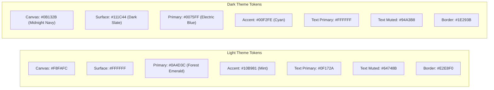

# Enterprise UI Design System & Component Guidelines

**Document Version**: 1.0  
**Phase**: Phase 0 — Foundation and Architecture Planning  
**Classification**: Enterprise UI/UX Specification  
**Status**: Implementation Ready  

---

## 1. Visual Design Philosophy & Reference Analysis

The design system for **EnterpriseManagement** establishes a bespoke, executive-tier enterprise SaaS aesthetic inspired by the approved reference images in `Docs/Design/References/`:

- **Light Mode Inspiration (`dashboard-light-reference.jpg`)**:
  - Clean Nordic/Swiss enterprise style.
  - Dominant deep forest emerald primary (`#0A4D3C`) paired with vibrant mint green indicators (`#10B981`).
  - Crisp, pure white card surfaces (`#FFFFFF`) elevated on a subtle cool slate canvas (`#F8FAFC`).
  - Ultra-clean borders (`#E2E8F0`), refined typographic hierarchy, and uncluttered data density.
- **Dark Mode Inspiration (`dashboard-dark-reference.jpg`)**:
  - Sophisticated midnight slate aesthetic.
  - Deep midnight navy canvas (`#0B132B`) with elevated dark slate card surfaces (`#111C44`).
  - Luminous electric cyan (`#0075FF` / `#00F2FE`) and mint emerald accents providing high-contrast visual cues.
  - Translucent border outlines (`#1E293B`) and smooth glowing chart curves.

> [!NOTE]
> The final user interface is an **original enterprise design** inspired by these reference directions, tailored specifically for our single-organization business operations workflows.

---

## 2. Reusable Design Tokens

### 2.1 Color Palette Specifications



#### Detailed Token Mapping

| Token Name | Light Theme Value | Dark Theme Value | Usage Description |
|---|---|---|---|
| `--color-canvas` | `#F8FAFC` | `#0B132B` | Root page background canvas |
| `--color-surface` | `#FFFFFF` | `#111C44` | Card, modal, and panel background surfaces |
| `--color-surface-hover` | `#F1F5F9` | `#1A2554` | Hover state for table rows and list items |
| `--color-border` | `#E2E8F0` | `#1E293B` | Card borders, table dividers, input borders |
| `--color-primary` | `#0A4D3C` | `#0075FF` | Primary action buttons, active navigation pills |
| `--color-primary-hover` | `#083B2E` | `#0060D0` | Primary button hover state |
| `--color-accent` | `#10B981` | `#00F2FE` | Trend indicators, secondary highlight accents |
| `--color-text-primary` | `#0F172A` | `#FFFFFF` | Headings, hero numbers, primary data cells |
| `--color-text-secondary`| `#475569` | `#CBD5E1` | Subtitles, table headers, form labels |
| `--color-text-muted` | `#64748B` | `#94A3B8` | Timestamps, placeholder text, breadcrumbs |
| `--color-status-success`| `#059669` | `#10B981` | Completed tasks, paid invoices, positive trends |
| `--color-status-warning`| `#D97706` | `#F59E0B` | In-progress milestones, approaching due dates |
| `--color-status-danger` | `#DC2626` | `#EF4444` | Overdue invoices, blocked tasks, negative trends|
| `--color-status-info` | `#0284C7` | `#38BDF8` | Informational badges, system updates |

### 2.2 Typography System
- **Primary Font Family**: `'Plus Jakarta Sans', 'Inter', -apple-system, BlinkMacSystemFont, sans-serif`.
- **Monospace Family (for codes & figures)**: `'JetBrains Mono', 'Fira Code', monospace`.
- **Typographic Scale**:
  - `Display / Hero KPI`: `2rem (32px)` | Semi-Bold (`600`) | Line Height: `1.2`
  - `Heading 1 (Page Title)`: `1.5rem (24px)` | Bold (`700`) | Line Height: `1.3`
  - `Heading 2 (Card Title)`: `1.125rem (18px)` | Semi-Bold (`600`) | Line Height: `1.4`
  - `Heading 3 (Section)`: `0.875rem (14px)` | Semi-Bold (`600`) | Uppercase, tracking `0.05em`
  - `Body Regular`: `0.875rem (14px)` | Regular (`400`) | Line Height: `1.5`
  - `Body Small / Caption`: `0.75rem (12px)` | Medium (`500`) | Line Height: `1.4`
  - `Micro / Badge`: `0.6875rem (11px)` | Semi-Bold (`600`) | Line Height: `1.3`

### 2.3 Spacing & 8-Point Baseline Grid
All layout paddings, margins, and component alignments align with the 8-point grid:
- `space-1`: `4px` (tight padding inside badges, icons)
- `space-2`: `8px` (button internal padding, gap between icon & label)
- `space-3`: `12px` (input padding, card compact spacing)
- `space-4`: `16px` (card internal body padding, grid gap)
- `space-6`: `24px` (page canvas padding, section spacing)
- `space-8`: `32px` (major container margins)
- `space-12`: `48px` (hero section separation)

### 2.4 Elevation, Shadows & Radii
- **Border Radii**:
  - Small (`rounded-sm`): `6px` (Badges, tags, tooltips)
  - Medium (`rounded-md`): `8px` (Form inputs, action buttons)
  - Large (`rounded-lg`): `12px` (Modals, dropdown panels)
  - Card Radius (`rounded-xl`): `16px` (Metric cards, data containers)
  - Pill (`rounded-pill`): `9999px` (Status badges, avatar rings, active nav pills)
- **Shadows**:
  - Light Card Shadow: `0 1px 3px rgba(0, 0, 0, 0.05), 0 1px 2px rgba(0, 0, 0, 0.03)`
  - Light Elevated Card: `0 10px 15px -3px rgba(0, 0, 0, 0.04), 0 4px 6px -2px rgba(0, 0, 0, 0.02)`
  - Dark Card Glow: `0 4px 20px rgba(0, 0, 0, 0.4), inset 0 1px 0 rgba(255, 255, 255, 0.05)`

---

## 3. PrimeNG Theming Architecture & Component Styling

### 3.1 Modern Theme Architecture
PrimeNG's modern styling tokens are mapped to our CSS custom properties. Switching between Light and Dark themes is accomplished by toggling the `.dark` class on the root `<html>` element.

### 3.2 PrimeNG Component Styling Directives
- **`p-table`**:
  - Clean headers with subtle background (`--color-surface-hover`).
  - High-density rows with vertical center alignment.
  - Hover highlights on data rows.
  - Custom paginators with pill-style active page buttons.
- **`p-card`**:
  - Border: `1px solid var(--color-border)`.
  - Border radius: `16px`.
  - Subtle elevation shadow; zero harsh outlines.
- **`p-button`**:
  - Primary button: Deep emerald in Light mode, Electric cyan in Dark mode.
  - Rounded corners (`8px`), smooth transition on hover (`transform: translateY(-1px)`).
- **`p-tag` & `p-badge`**:
  - Pill shape (`border-radius: 9999px`).
  - Muted background tint with high-contrast text for semantic states (`Success`, `Warning`, `Danger`, `Info`).

---

## 4. Bootstrap 5 Integration & Isolation Strategy

To prevent CSS collisions between Bootstrap and PrimeNG:

1. **Selective SCSS Imports**:
   ```scss
   // styles.scss
   // Exclusively import Bootstrap Grid and Flexbox utilities
   @import "bootstrap/scss/functions";
   @import "bootstrap/scss/variables";
   @import "bootstrap/scss/maps";
   @import "bootstrap/scss/mixins";
   @import "bootstrap/scss/root";
   @import "bootstrap/scss/containers";
   @import "bootstrap/scss/grid";
   @import "bootstrap/scss/utilities";
   ```
2. **Explicitly Excluded Bootstrap Styles**:
   - `bootstrap/scss/buttons` (PrimeNG `p-button` is used exclusively).
   - `bootstrap/scss/forms` (PrimeNG `p-inputtext`, `p-select`, `p-checkbox` are used exclusively).
   - `bootstrap/scss/tables` (PrimeNG `p-table` is used exclusively).
   - `bootstrap/scss/card` (PrimeNG `p-card` is used exclusively).
   - `bootstrap/scss/modal` (PrimeNG `p-dialog` is used exclusively).

---

## 5. Standard Component Patterns

### 5.1 KPI Metric Cards (Reference Pattern)
Directly modeled after the top row in `dashboard-light-reference.jpg`:
- Card surface with `16px` border radius and `1px solid var(--color-border)`.
- Top: Metric label (e.g., `TOTAL REVENUE`, `ACTIVE PROJECTS`) + 3-dots action context icon.
- Middle: Large hero value (e.g., `$1.5M`, `1,200`) in bold typography.
- Bottom: Semantic badge pill with trend direction (e.g., `+12% ↑` in mint emerald or `-7% ↓` in crimson) + historical comparison text (e.g., `vs. last month`).

### 5.2 Interactive Chart Widgets
- Powered by **Chart.js** via `p-chart`.
- Responsive canvas container with fixed aspect ratio.
- Grid lines styled with translucent border color (`rgba(226, 232, 240, 0.5)` in Light; `rgba(30, 41, 59, 0.5)` in Dark).
- Multi-series curves rendered with smooth tension (`tension: 0.4`), gradient area fills, and tooltip callouts styled with our design tokens.

