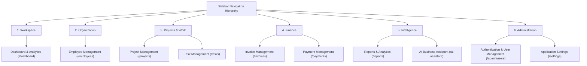

# Navigation Hierarchy & Menu Architecture: EnterpriseManagement

**Document Version:** 1.0
**Phase:** Phase 1.2 — UI/UX Design & Prototyping
**Classification:** Enterprise Navigation & Information Architecture
**Status:** Approved for Implementation Planning
**Related Documents:**
- [UI-UX-Design-Specification.md](./UI-UX-Design-Specification.md)
- [Application-Layout-Blueprint.md](./Application-Layout-Blueprint.md)
- [Dashboard-Wireframe-Specification.md](./Dashboard-Wireframe-Specification.md)
- [Responsive-Design-Specification.md](./Responsive-Design-Specification.md)
- [Theme-Visual-Specification.md](./Theme-Visual-Specification.md)

---

## 1. Document Purpose & Scope

This specification establishes the authoritative information architecture and navigation hierarchy for **EnterpriseManagement**. It details the exact grouped sidebar navigation structure, icon semantics, active and interaction states, responsive drawer behavior, and role-based visibility principles.

### Scope Boundaries
- **In Scope:** Menu categorization, module grouping, route URL mapping, icon semantics, interaction states, and role-aware visibility guidelines.
- **Out of Scope:** Concrete permission-checking directive code (`*hasPermission`), backend role-permission database seed tables, or Angular Router route definition code.

---

## 2. Approved Grouped Navigation Structure

In accordance with Phase 1.2 design governance, the application organizes the **strictly ten approved business modules** into **six logical business groups**:

---

## 3. Comprehensive Navigation Group Catalog

| Group Header | Module Name | Route URL | Primary Icon (Font Awesome) | Secondary Icon (PrimeIcons) | Business Responsibility Summary |
|---|---|---|---|---|---|
| **Workspace** | **Dashboard & Analytics** | `/dashboard` | `fas fa-chart-pie` | `pi pi-chart-pie` | Centralized operational health, KPI cards, and cross-module velocity. |
| **Organization** | **Employee Management** | `/employees` | `fas fa-users` | `pi pi-users` | Personnel directory, departmental structures, profiles, and employment statuses. |
| **Projects & Work**| **Project Management** | `/projects` | `fas fa-folder-tree` | `pi pi-folder` | Project portfolio, milestones, delivery timelines, budgets, and allocations. |
| | **Task Management** | `/tasks` | `fas fa-list-check` | `pi pi-check-square`| Task execution, sprint assignments, priority boards, and completion tracking. |
| **Finance** | **Invoice Management** | `/invoices` | `fas fa-file-invoice-dollar`| `pi pi-file` | Customer billing, invoice issuance, aging reports, and balance tracking. |
| | **Payment Management** | `/payments` | `fas fa-credit-card` | `pi pi-wallet` | Payment processing, ledger reconciliation, transaction records, receipts. |
| **Intelligence** | **Reports & Analytics** | `/reports` | `fas fa-chart-line` | `pi pi-chart-line`| Fiscal statements, operational metrics, exportable audit reports. |
| | **AI Business Assistant** | `/ai-assistant` | `fas fa-brain` | `pi pi-sparkles` | Entry point for 3 approved AI capabilities: AI Dashboard Summary, AI Business Insights, AI Natural Language Query (detailed functional behaviors: proposed functional behavior). |
| **Administration** | **Authentication & User Management** | `/admin/users` | `fas fa-user-shield` | `pi pi-shield` | User provisioning, role assignment, security audit logs, account lockout policies. |
| | **Application Settings** | `/settings` | `fas fa-sliders` | `pi pi-cog` | System preferences, localization defaults, security rules, notification setups. |

---

## 4. Navigation Interaction States & Visual Feedback

### 4.1 Visual States
- **Resting / Inactive:**
  - Background: Transparent.
  - Text Color: Secondary slate (`#475569` in Light / `#CBD5E1` in Dark).
  - Icon Color: Muted slate (`#64748B` in Light / `#94A3B8` in Dark).
- **Hover:**
  - Background: Subtle tint (`#F1F5F9` in Light / `#1E293B` in Dark).
  - Text Color: Primary text (`#0F172A` in Light / `#FFFFFF` in Dark).
  - Transition: `150ms cubic-bezier(0.4, 0, 0.2, 1)`.
- **Active / Current Route:**
  - Background: Brand Teal Light tint (`#CCFBF1` at 80% opacity in Light / `#115E59` at 40% in Dark).
  - Text Color: Primary Teal (`#0F766E` in Light / `#2DD4BF` in Dark), font weight Semi-Bold (`600`).
  - Leading Indicator: A crisp `3px` solid teal vertical indicator on the left border of the menu item.
- **Focus Visible:**
  - Standard accessible 2px focus ring (`#0D9488`).

### 4.2 Group Headers Styling
- Visual Style: Uppercase, small tracking (`tracking: 0.05em`), font size `11px` (`0.6875rem`), font weight Semi-Bold (`600`).
- Text Color: Neutral muted slate (`#94A3B8` in Light / `#64748B` in Dark).
- Padding: `16px 16px 6px 16px`.
- Purpose: Clearly sections the navigation tree without adding click-heavy accordion complexity.

---

## 5. Sidebar Layout Modes & Responsive Drawer Behavior

### 5.1 Expanded Mode (Desktop `>=1200px`)
- Full width: `260px` (matches runtime token `--em-layout-sidebar-width` in `_themes.scss`).
- Group headings, module icons, module labels, and optional count badges (e.g., active task count) are visible.
- Sidebar is fixed to the left of the viewport canvas.

### 5.2 Compact / Collapsed Rail Mode (Tablet `768px–1199px`)
- Compact width: `68px` (proposed design measurement; existing runtime placeholder in `_themes.scss` is `72px`).
- Group headings and text labels are hidden.
- Module icons are centered (`size: 20px`).
- Hovering over an icon displays an anchored PrimeNG tooltip (`pTooltip`) with the module name and group context.
- Allows maximum horizontal canvas space for complex data tables and multi-column dashboards.

### 5.3 Mobile Off-Canvas Drawer (`<768px`)
- Default state: Completely hidden off-screen (`transform: translateX(-100%)`).
- Activation: Triggered by the mobile hamburger icon button in the top header.
- Presentation: Slides smoothly from the left as an overlay drawer (`width: 280px`) with a dimmed backdrop overlay (`rgba(15, 23, 42, 0.5)`).
- Dismissal: Clicking outside the drawer, swiping left, pressing the `Escape` key, or selecting any navigation route immediately closes the drawer.

---

## 6. Proposed Navigation Role Visibility (UX Guidance Only)

### 6.1 Proposed Navigation Scoping Guidelines
While the enterprise system maintains strictly 10 approved modules, the following table details **proposed navigation visibility** designed purely as a user-experience convenience to reduce cognitive overhead and interface clutter across different operational roles.

> [!WARNING]
> **Governance Classification: Proposed Navigation Visibility Only**
> This table is **strictly a proposed UX navigation visibility guideline** and must **not** be construed as a final approved RBAC, PBAC, or authorization matrix. It does not confer security access or permissions. Definitive, authoritative authorization is governed exclusively by backend policy handlers enforced via the PBAC pipeline, and formally specified in `Docs/Requirements/Role-Permission-Matrix.md` and `AGENTS.md`. Frontend visibility masking is a presentation convenience; backend authorization remains authoritative.

| Module | Admin | Manager | Employee | Project Manager | Finance Manager |
|---|:---:|:---:|:---:|:---:|:---:|
| **Dashboard & Analytics** | Visible | Visible | Visible | Visible | Visible |
| **Employee Management** | Visible | Visible | Visible (Directory) | Visible (Directory) | Visible (Directory) |
| **Project Management** | Visible | Visible | Visible (Assigned) | Visible | Visible (Budget View) |
| **Task Management** | Visible | Visible | Visible (Assigned) | Visible | Visible (Audit) |
| **Invoice Management** | Visible | Visible (Dept) | Hidden | Hidden | Visible |
| **Payment Management** | Visible | Visible (Dept) | Hidden | Hidden | Visible |
| **Reports & Analytics** | Visible | Visible | Hidden | Visible (Project) | Visible (Fiscal) |
| **AI Business Assistant** | Visible | Visible | Hidden | Visible | Visible |
| **Authentication & User Management** | Visible | Hidden | Hidden | Hidden | Hidden |
| **Application Settings** | Visible | Hidden | Hidden | Hidden | Hidden |

---

## 7. Document Status & Approvals

| Decision Area | Status | Notes |
|---|---|---|
| 6 Groups / 10 Modules Structure | **Approved** | Exactly 10 modules; zero additions, merges, or renames. |
| Icon Library Standard | **Approved** | Font Awesome (Primary), PrimeIcons (Secondary). |
| Responsive Drawer Behavior | **Approved** | 260px expanded, 68px rail, mobile off-canvas drawer. |
| Navigation Role Visibility | *Proposed Navigation Visibility* | Proposed UX convenience scoping guideline only. Not an approved RBAC or authorization matrix. Authoritative authorization is defined in `Docs/Requirements/Role-Permission-Matrix.md`. |
| Navigation Component Implementation | *Phase 3: Frontend Foundation & Core UI Architecture* | Grouped sidebar, route configuration, and responsive drawer components to be implemented in Phase 3. Phase 1.2 is strictly documentation-only. |

---

## 8. Measurement Classification & Governance

| Measurement Area | Dimension / Value | Governance Classification | Verification Reference / Notes |
|---|---|---|---|
| **Expanded Sidebar Width** | `260px` | **Verified Existing Project Configuration** | Runtime token `--em-layout-sidebar-width: 260px` in `_themes.scss`. |
| **Header Height** | `64px` | **Verified Existing Project Configuration** | Runtime token `--em-layout-header-height: 64px` in `_themes.scss`. |
| **Approved Group Count** | Exactly 6 Groups | **Approved Design Decision** | Workspace, Organization, Projects & Work, Finance, Intelligence, Administration. |
| **Approved Module Count** | Exactly 10 Modules | **Approved Design Decision** | Single-organization architecture invariant per `AGENTS.md`. |
| **Role Visibility Scoping** | Per-role menu display | **Proposed Navigation Visibility** | UX convenience guideline only; backend PBAC remains authoritative per `AGENTS.md`. |
| **Compact Sidebar Rail** | `68px` | **Proposed Design Measurement** | Ergonomic icon rail; runtime placeholder in `_themes.scss` is `72px` (to be aligned in Phase 3). |
| **Mobile Drawer Width** | `280px` | **Proposed Design Measurement** | Viewport overlay drawer width on mobile devices (`<768px`). |
| **Navigation Icon Size** | `18px` to `20px` | **Proposed Design Measurement** | Centered icon sizing in compact rail and expanded menu. |
| **Active Border Indicator** | `3px` solid teal | **Proposed Design Measurement** | High-contrast left indicator for active route item. |
| **Runtime Token Alignment**| Sync `68px` compact rail token | **Pending Roadmap Confirmation** | Subject to formal confirmation in Phase 3 or subsequent frontend roadmap milestone. |
