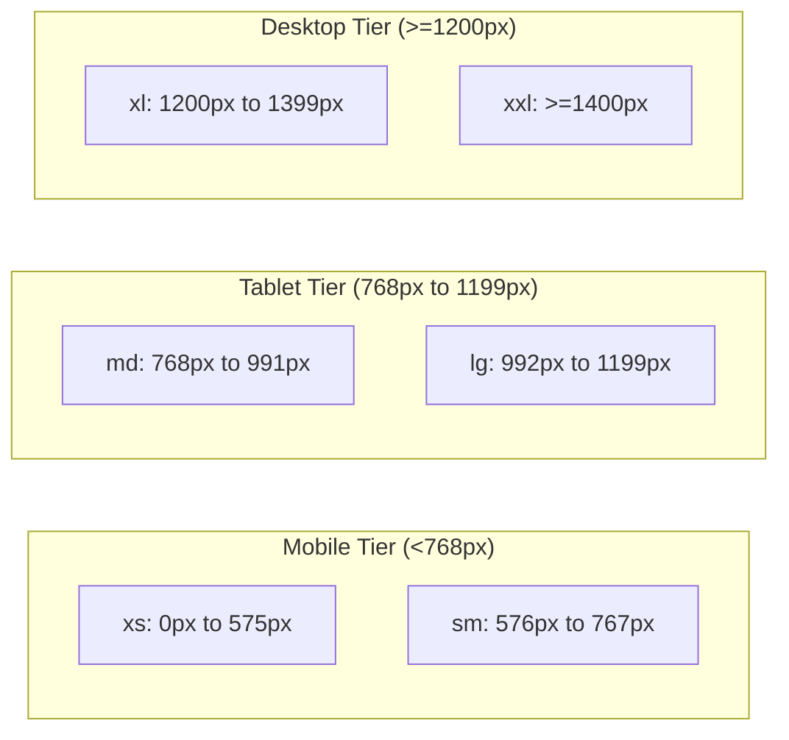

# Responsive Design Specification: EnterpriseManagement

**Document Version:** 1.0
**Phase:** Phase 1.2 — UI/UX Design & Prototyping
**Classification:** Enterprise Responsive Design & Viewport Specification
**Status:** Approved for Implementation Planning
**Related Documents:**
- [UI-UX-Design-Specification.md](./UI-UX-Design-Specification.md)
- [Application-Layout-Blueprint.md](./Application-Layout-Blueprint.md)
- [Navigation-Hierarchy.md](./Navigation-Hierarchy.md)
- [Dashboard-Wireframe-Specification.md](./Dashboard-Wireframe-Specification.md)
- [Theme-Visual-Specification.md](./Theme-Visual-Specification.md)

---

## 1. Document Purpose & Architectural Alignment

This specification establishes the responsive design standards, adaptive viewport behaviors, touch ergonomical targets, and layout transformations for **EnterpriseManagement**.

To maintain total consistency across design and engineering, all breakpoint definitions are strictly anchored to the existing SCSS compile-time tokens declared in `Frontend/src/assets/styles/_variables.scss` and standard Bootstrap 5 grid tiers.

### Scope Boundaries
- **In Scope:** Viewport breakpoint thresholds, container widths, layout reflow rules, data table adaptation, Chart.js canvas responsiveness, touch targets, and mobile form ergonomics.
- **Out of Scope:** Concrete CSS media query writing, Sass file edits, or component implementation code.

---

## 2. Breakpoint Architecture & Viewport Tiers

The application defines three primary operational tiers mapped to the underlying six SCSS grid breakpoints:

### Breakpoint Mapping to Existing Design Tokens

| Tier Name | Breakpoint Range | SCSS Compile-Time Token | Max Container Width | Primary Hardware Profile |
|---|---|---|---|---|
| **Mobile Extra-Small** | `<576px` | `$breakpoint-xs: 0` | Fluid (`100%`) | Smartphones (portrait) |
| **Mobile Small** | `576px – 767px` | `$breakpoint-sm: 576px` | `540px` (`$container-sm`) | Large smartphones, mini tablets |
| **Tablet Portrait** | `768px – 991px` | `$breakpoint-md: 768px` | `720px` (`$container-md`) | Standard tablets (portrait) |
| **Tablet Landscape**| `992px – 1199px` | `$breakpoint-lg: 992px` | `960px` (`$container-lg`) | Tablets (landscape), small laptops |
| **Desktop Standard**| `1200px – 1399px`| `$breakpoint-xl: 1200px`| `1140px` (`$container-xl`)| Enterprise workstations, laptops |
| **Desktop Ultra-Wide**| `>=1400px` | `$breakpoint-xxl: 1400px`| `1320px` (`$container-xxl`)| High-resolution enterprise monitors |

---

## 3. Layout Transformations by Viewport Tier

### 3.1 Desktop Tier (`>=1200px`)
- **Navigation:** Persistent, fully expanded sidebar (`260px` fixed width) displaying brand identity, group headers, module labels, and count badges.
- **Header:** Full breadcrumb hierarchy (`Workspace / Dashboard / Overview`), omnibox search input (`320px` wide), language switcher, notification icon with unread count, and full profile pill.
- **Dashboard Grid:** Multi-column layout featuring a row of 4 KPI cards (`col-xl-3`), two-column analytical chart and AI assistant split (`col-xl-8` and `col-xl-4`), and side-by-side data tables (`col-xl-6`).
- **Data Tables:** Multi-column tabular view displaying up to 8–10 columns simultaneously without horizontal pagination.

### 3.2 Tablet Tier (`768px – 1199px`)
- **Navigation:** Sidebar collapses automatically into a compact icon rail (`68px` fixed width). Group headers and text labels hide; icons center. Hovering an icon surfaces an anchored tooltip (`pTooltip`).
- **Header:** Omnibox search condenses to an interactive search icon that expands upon focus; breadcrumbs shorten to display the immediate parent and current view title.
- **Dashboard Grid:** Two-column grid reflow. KPI cards render in a 2x2 grid (`col-md-6`). Analytical charts and AI panels stack vertically (`col-12`).
- **Data Tables:** Tables gain a fluid horizontal scroll wrapper with frozen first column (`Name` or `Invoice #`) to maintain identification during scrolling.

### 3.3 Mobile Tier (`<768px`)
- **Navigation:** Sidebar is completely detached from the document flow and concealed off-canvas. Activated exclusively via a top header hamburger button, sliding in as an overlay drawer (`280px` wide) over a darkened modal backdrop.
- **Header:** Height remains `64px` but content is optimized: Hamburger trigger on left, active page title in center, and profile avatar on right. Search and language triggers move into an expandable sub-bar or drawer.
- **Dashboard Grid:** Single-column vertical stack (`col-12`). KPI cards stack vertically or swipe horizontally in a snap-scroll container. All chart widgets expand to 100% viewport width.
- **Data Tables:** Tables transform into responsive card-list views or swipeable horizontal containers to prevent layout breaking.

---

## 4. Specific Component Responsiveness Guidelines

### 4.1 Data Tables (`p-table`)
1. **Desktop:** Standard enterprise density with sortable headers, multi-select checkboxes, and action icon buttons.
2. **Tablet:** Horizontal scrolling enabled with subtle scroll indicator shadow on the right edge.
3. **Mobile Transformation:**
   - For simple tables (under 4 columns): Horizontal scroll container.
   - For complex records (Invoices, Projects, Employees): Each table row collapses into an elevated card displaying key primary metadata on top, with a collapsible drawer or modal for secondary details.

### 4.2 Chart.js Responsive Canvas
1. **Direct Canvas Integration:** The native `<canvas>` element must declare `responsive: true` and `maintainAspectRatio: false` in its Chart.js configuration.
2. **Container Constraints:** The canvas is wrapped inside a responsive CSS container declaring explicit aspect ratios:
   - *Desktop:* Height fixed at `320px` to `360px`.
   - *Tablet:* Height fixed at `280px`.
   - *Mobile:* Height fixed at `220px` to `240px` with horizontal pan capability for dense time-series.
3. **Legend & Labels:** Chart legends move from right-aligned to bottom-aligned on mobile viewports to preserve chart plotting area.

### 4.3 Modal Dialogs (`p-dialog`)
1. **Desktop:** Centered overlay with explicit maximum width (`600px` for standard forms, `900px` for multi-step wizards).
2. **Tablet:** Responsive width (`80vw`).
3. **Mobile:** Dialog transforms into a full-screen modal or bottom sheet (`width: 100vw; height: 100vh; margin: 0; border-radius: 0`) with a prominent top close button to maximize keyboard input space.

### 4.4 Form Controls & Touch Targets
1. **Touch Target Sizing:** In accordance with WCAG 2.1 AA criteria, all interactive mobile targets (buttons, checkboxes, pagination controls, icons) must declare a minimum touch target area of **`44px x 44px`**.
2. **Form Stacking:** Multi-column form layouts (`col-md-6`) on desktop collapse into a single vertical sequence (`col-12`) on viewports `<768px`.
3. **Input Padding:** Input text fields declare a minimum height of `44px` on mobile to prevent accidental zooming on iOS devices.

---

## 5. Device Orientation & Content Priority

- **Portrait (Mobile Default):** Information architecture prioritizes immediate operational needs: High-priority alerts, immediate action tasks, and primary KPI figures appear above the fold.
- **Landscape (Mobile/Tablet):** Canvas height is constrained; sticky headers reduce in padding to `48px` to preserve vertical visibility for data tables.
- **Content Priority Hierarchy:**
  1. *Priority 1 (Always Visible):* Current status alerts, primary action buttons, top 2 KPI figures.
  2. *Priority 2 (Secondary Scroll):* Operational charts, active project lists, task queues.
  3. *Priority 3 (Bottom or Tabbed):* Historical audit streams, system metadata, secondary configuration links.

---

## 6. Document Status & Approvals

| Responsive Dimension | Status | Implementation Notes |
|---|---|---|
| Breakpoint Tiers Alignment | **Approved** | Exactly mapped to `$breakpoint-*` in `_variables.scss`. |
| Sidebar Transformation | **Approved** | 260px expanded -> 68px rail -> mobile off-canvas drawer. |
| Table Responsive Reflow | **Approved** | Sticky frozen column on tablet; card transform on mobile. |
| Touch Target Minimum (44px) | **Approved** | WCAG 2.1 AA compliance criterion enforced. |
| Responsive Implementation | *Phase 3: Frontend Foundation & Core UI Architecture* | Responsive layout styles, media queries, and component adaptations to be implemented in Phase 3. Phase 1.2 is strictly documentation-only. |

---

## 7. Responsive Measurement Classification & Governance

| Measurement Area | Dimension / Value | Governance Classification | Verification Reference / Notes |
|---|---|---|---|
| **Breakpoints (xs, sm, md, lg, xl, xxl)** | `0`, `576px`, `768px`, `992px`, `1200px`, `1400px` | **Verified Existing Project Configuration** | Compile-time tokens `$breakpoint-*` in `_variables.scss`. |
| **Max Container Widths** | `540px`, `720px`, `960px`, `1140px`, `1320px` | **Verified Existing Project Configuration** | Compile-time tokens `$container-*` in `_variables.scss`. |
| **Canvas Padding** | `24px` (`$spacing-6`) | **Verified Existing Project Configuration** | Compile-time token `$spacing-6: 1.5rem` in `_variables.scss`. |
| **Touch Target Area** | Minimum `44px x 44px` | **Approved Design Decision** | WCAG 2.1 AA compliance mandate. |
| **Sidebar Breakpoints** | `>=1200px` expanded, `768–1199px` rail, `<768px` drawer | **Approved Design Decision** | Responsive layout tiers approved in Phase 1.2. |
| **Chart Height (Desktop)** | `320px` to `360px` | **Proposed Design Measurement** | Aspect-constrained Chart.js canvas container. |
| **Chart Height (Tablet)** | `280px` | **Proposed Design Measurement** | Compact height for tablet viewport. |
| **Chart Height (Mobile)** | `220px` to `240px` | **Proposed Design Measurement** | Height-optimized canvas with horizontal pan capability. |
| **Dialog Width (Standard)**| Max `600px` | **Proposed Design Measurement** | Centered modal container for standard forms. |
| **Dialog Width (Wizard)** | Max `900px` | **Proposed Design Measurement** | Multi-step form dialog maximum width. |
| **Dialog (Mobile)** | `100vw x 100vh` (Full-Screen) | **Proposed Design Measurement** | Full-screen transformation preventing keyboard clipping. |
| **Form Input Mobile Height**| `44px` minimum | **Proposed Design Measurement** | Ergonomic input height preventing mobile auto-zoom. |
| **Component Media Queries** | Fine-tuned component breakpoints | **Pending Roadmap Confirmation** | Specific component-level CSS thresholds subject to verification during respective component phases. |
