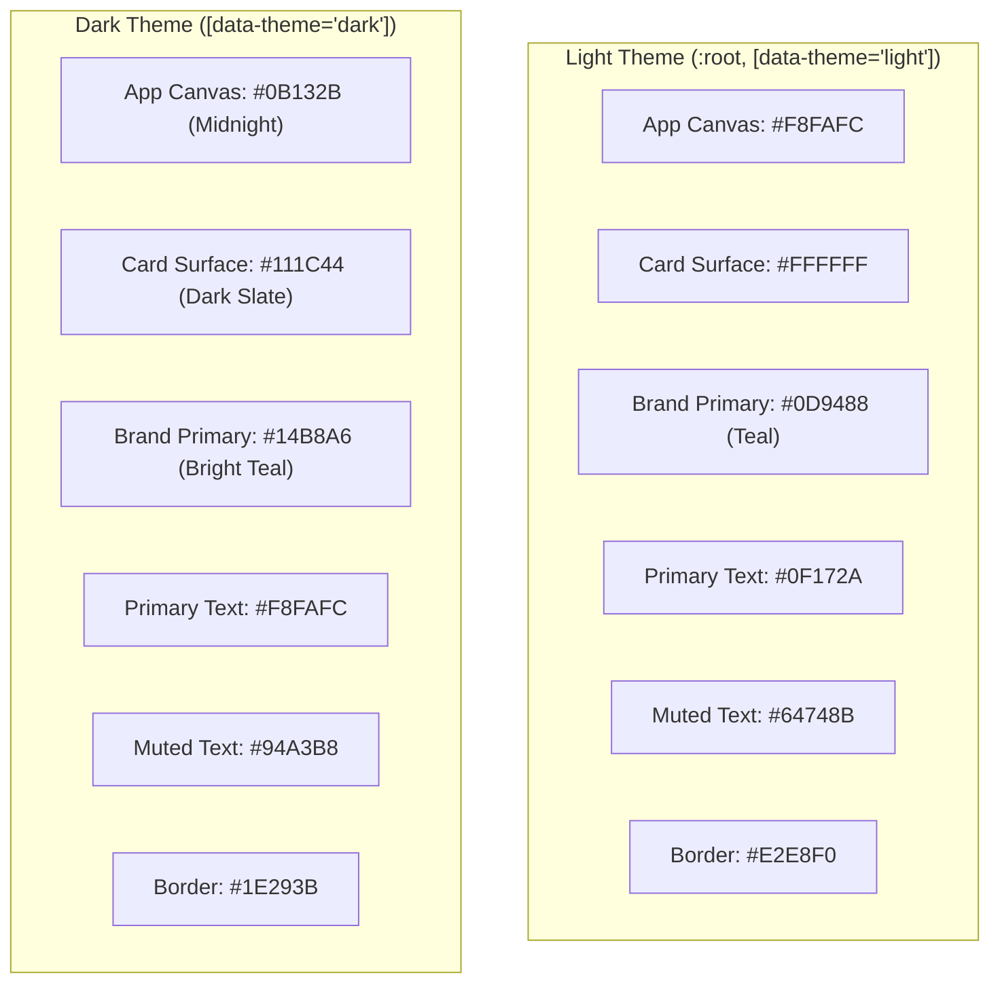

# Theme & Visual Specification: EnterpriseManagement

**Document Version:** 1.0
**Phase:** Phase 1.2 — UI/UX Design & Prototyping
**Classification:** Enterprise Visual Design & Theming Specification
**Status:** Approved for Implementation Planning
**Related Documents:**
- [UI-UX-Design-Specification.md](./UI-UX-Design-Specification.md)
- [Application-Layout-Blueprint.md](./Application-Layout-Blueprint.md)
- [Navigation-Hierarchy.md](./Navigation-Hierarchy.md)
- [Dashboard-Wireframe-Specification.md](./Dashboard-Wireframe-Specification.md)
- [Responsive-Design-Specification.md](./Responsive-Design-Specification.md)

---

## 1. Document Purpose & Architectural Foundation

This specification establishes the visual theme architecture and design token behavior for both the **Light Theme** (default) and **Dark Theme** of **EnterpriseManagement**.

It builds upon the Phase 1.1.4 architectural foundation:
- **CSS Custom Properties Engine:** Centralized runtime variables (`--em-*`) toggled via the root `data-theme` attribute.
- **Light Theme Selector:** `:root, [data-theme='light']`.
- **Dark Theme Selector:** `[data-theme='dark']`.
- **PrimeNG Custom Preset:** `EnterprisePreset` leveraging `definePreset(Aura, ...)` in `@core/theme/prime-preset.ts` and `darkModeSelector: '[data-theme="dark"]'`.

> [!IMPORTANT]
> **Implementation Boundary**: This document is a **visual design specification**. It defines intended colors, contrast ratios, and token relationships conceptually. It strictly does **not** alter existing SCSS files, does not change PrimeNG code, and does not implement theme persistence or UI switcher components.

---

## 2. Visual Design Philosophy & Reference Lineage

The visual aesthetic of EnterpriseManagement is directly informed by the approved executive reference mockups in `Docs/Design/References/`:

- **Light Mode Direction (`dashboard-light-reference.jpg`):**
  - Crisp, clinical Nordic enterprise aesthetic.
  - Pure white elevated cards (`#FFFFFF`) on a calm slate canvas (`#F8FAFC`).
  - Brand Teal accents (`#0D9488`) providing clear visual focal points without overwhelming data density.
  - Subtle divider outlines (`#E2E8F0`) with zero visual clutter.
- **Dark Mode Direction (`dashboard-dark-reference.jpg`):**
  - Sophisticated midnight operations center aesthetic.
  - Deep midnight navy canvas (`#0B132B`) with elevated dark slate/navy card surfaces (`#111C44`).
  - Luminous teal (`#14B8A6`) and mint emerald accents ensuring effortless readability in low-light environments.
  - Calibrated translucent borders (`#1E293B`) creating elegant card separation without harsh glare.

---

## 3. Comprehensive Theme Token Specifications

### 3.1 Color & Surface Architecture

### 3.2 Visual Token Mapping Table

| UI Component Area | Conceptual Token | Light Theme Specification | Dark Theme Specification | Visual Purpose & Context |
|---|---|---|---|---|
| **Viewport Background** | `bg-app` | `#F8FAFC` (Cool Slate) | `#0B132B` (Deep Midnight) | Primary application canvas backdrop. |
| **Container Surfaces** | `bg-surface` | `#FFFFFF` (Pure White) | `#111C44` (Dark Slate) | KPI cards, data widgets, modals, dropdowns. |
| **Interactive Row Hover**| `surface-hover` | `#F1F5F9` (Soft Slate) | `#1E293B` (Translucent Slate)| Hover state on table rows and list items. |
| **Component Borders** | `border-default`| `#E2E8F0` (Crisp Border) | `#1E293B` (Subtle Outline) | Card perimeter borders, table row dividers. |
| **Primary Brand Accent**| `primary` | `#0D9488` (Teal 600) | `#14B8A6` (Teal 500) | Primary action CTAs, active menu items. |
| **Primary Accent Hover**| `primary-hover`| `#0F766E` (Teal 700) | `#2DD4BF` (Teal 400) | Interactive button hover and pressed states. |
| **Primary Soft Tint** | `primary-soft` | `#CCFBF1` (Teal 100) | `#115E59` (Teal 900) | Active menu background tint, tag backgrounds.|
| **Primary Text** | `text-primary` | `#0F172A` (Slate 900) | `#F8FAFC` (Slate 50) | Major titles, KPI numbers, primary table cells.|
| **Secondary Text** | `text-secondary`| `#475569` (Slate 600) | `#CBD5E1` (Slate 300) | Subheadings, table headers, form labels. |
| **Muted Text** | `text-muted` | `#64748B` (Slate 500) | `#94A3B8` (Slate 400) | Input placeholders, timestamps, helper text. |

---

## 4. Semantic Status & System Indicators

Status indicators communicate operational health uniformly across both themes while adjusting background tints for contrast:

| Semantic State | Indicator Color | Light Mode Badge Tint | Dark Mode Badge Tint | Business Application |
|---|---|---|---|---|
| **Success** | `#10B981` (Emerald) | `#D1FAE5` (Text: `#065F46`) | `#064E3B` (Text: `#6EE7B7`) | Completed tasks, paid invoices, healthy velocity. |
| **Warning** | `#F59E0B` (Amber) | `#FEF3C7` (Text: `#92400E`) | `#78350F` (Text: `#FDE68A`) | Approaching due dates, unapproved timesheets. |
| **Danger / Error** | `#EF4444` (Rose) | `#FEE2E2` (Text: `#991B1B`) | `#7F1D1D` (Text: `#FCA5A5`) | Overdue billing, blocked tasks, failed logins. |
| **Info** | `#3B82F6` (Sky Blue) | `#DBEAFE` (Text: `#1E40AF`) | `#1E3A8A` (Text: `#93C5FD`) | System announcements, schedule updates. |

---

## 5. Component Visual Specifications by Theme

### 5.1 Buttons & Interactive Controls
- **Primary Action Button:**
  - *Light Mode:* Solid Teal (`#0D9488`), white text (`#FFFFFF`), hover `#0F766E`.
  - *Dark Mode:* Solid Bright Teal (`#14B8A6`), dark midnight text (`#0F172A`), hover `#2DD4BF`.
- **Secondary Outlined Button:**
  - *Light Mode:* 1px solid border (`#E2E8F0`), text `#0F172A`, hover `#F1F5F9`.
  - *Dark Mode:* 1px solid border (`#1E293B`), text `#F8FAFC`, hover `#1E293B`.
- **Form Inputs (`p-inputtext`, `p-select`):**
  - *Light Mode:* White surface, 1px border `#E2E8F0`, focus ring `0 0 0 2px rgba(13, 148, 136, 0.2)`.
  - *Dark Mode:* Slate surface (`#162038`), 1px border `#1E293B`, focus ring `0 0 0 2px rgba(20, 184, 166, 0.3)`.

### 5.2 Data Tables (`p-table`)
- **Header Row:**
  - *Light Mode:* Shaded cool slate (`#F1F5F9`), uppercase text (`#475569`), border `#E2E8F0`.
  - *Dark Mode:* Deep navy surface (`#162038`), uppercase text (`#CBD5E1`), border `#1E293B`.
- **Data Rows:**
  - *Light Mode:* White background, hover `#F8FAFC`, bottom border `#E2E8F0`.
  - *Dark Mode:* Navy background (`#111C44`), hover `#1A2554`, bottom border `#1E293B`.

### 5.3 Modal Dialogs (`p-dialog`)
- **Card Container:**
  - *Light Mode:* Pure white surface with `0 20px 25px -5px rgba(0, 0, 0, 0.1)`.
  - *Dark Mode:* Elevated dark slate (`#111C44`) with `0 20px 25px -5px rgba(0, 0, 0, 0.5)` and 1px border `#1E293B`.
- **Backdrop Mask:** `rgba(15, 23, 42, 0.6)` across both themes.

### 5.4 Chart.js Visual Styling Standards
- **Gridlines:**
  - *Light Mode:* Translucent slate (`rgba(226, 232, 240, 0.8)`).
  - *Dark Mode:* Translucent navy (`rgba(30, 41, 59, 0.8)`).
- **Primary Series Curve:**
  - Line color: Brand Teal (`#0D9488` in Light / `#14B8A6` in Dark).
  - Area fill: Vertical gradient fading from `rgba(13, 148, 136, 0.25)` to `rgba(13, 148, 136, 0.0)`.
- **Crosshair Tooltip:**
  - *Light Mode:* Dark slate background (`#0F172A`) with white text and 4px radius.
  - *Dark Mode:* Pure white background (`#FFFFFF`) with dark text (`#0F172A`) and 4px radius.

---

## 6. Accessibility & Contrast Verification

All specified color pairs satisfy **WCAG 2.1 AA** criteria:
- **Light Text Primary (`#0F172A`) on Light Canvas (`#F8FAFC`):** Contrast ratio `15.8:1` (Passes AAA).
- **Dark Text Primary (`#F8FAFC`) on Dark Canvas (`#0B132B`):** Contrast ratio `17.4:1` (Passes AAA).
- **Brand Teal (`#0D9488`) on White (`#FFFFFF`):** Contrast ratio `4.6:1` for UI components and large text (Passes AA).
- **Bright Teal (`#14B8A6`) on Dark Surface (`#111C44`):** Contrast ratio `5.2:1` (Passes AA).

---

## 7. Document Status & Approvals

| Theme Dimension | Status | Notes |
|---|---|---|
| Teal Brand Accent Integration | **Approved** | Synchronized across Light and Dark specifications. |
| Dark Midnight Surface Strategy | **Approved** | Deep navy `#0B132B` canvas and `#111C44` card surfaces. |
| PrimeNG Aura Preset Alignment | **Approved** | Built on existing Phase 1.1.4 `EnterprisePreset`. |
| Implementation Execution | *Phase 3: Frontend Foundation & Core UI Architecture* | Concrete SCSS token updates (including updating primary brand tokens to Teal `#0D9488` from initial setup blue `#2563eb`) and component styling to be implemented in Phase 3. Phase 1.2 is strictly documentation-only. |

---

## 8. Theme Measurement & Token Classification Governance

| Token / Measurement Area | Value / Hex Code | Governance Classification | Verification Reference / Notes |
|---|---|---|---|
| **Theme Runtime Shell Dimensions** | Header `64px`, Footer `48px`, Sidebar `260px` | **Verified Existing Project Configuration** | Declared in `:root` in `Frontend/src/assets/styles/_themes.scss`. |
| **Collapsed Sidebar Placeholder** | `72px` | **Verified Existing Project Configuration** | Declared as `--em-layout-sidebar-collapsed-width: 72px` in `_themes.scss`. |
| **PrimeNG Aura Integration** | `EnterprisePreset` | **Verified Existing Project Configuration** | Configured in `Frontend/src/app/core/theme/prime-preset.ts`. |
| **Primary Brand Accent (Teal)** | `#0D9488` (Light) / `#14B8A6` (Dark) | **Approved Design Decision** | Approved in Phase 1.2; replaces initial setup blue `#2563eb`. |
| **Canvas & Card Surfaces (Light)** | Canvas `#F8FAFC`, Surface `#FFFFFF` | **Approved Design Decision** | Aligned with executive reference `dashboard-light-reference.jpg`. |
| **Canvas & Card Surfaces (Dark)** | Canvas `#0B132B`, Surface `#111C44` | **Approved Design Decision** | Aligned with executive reference `dashboard-dark-reference.jpg`. |
| **Dual Theme Support** | `[data-theme='light']`, `[data-theme='dark']` | **Approved Design Decision** | Dynamic runtime theme switching architecture. |
| **Card Drop Shadows** | `0 1px 3px rgba(0,0,0,0.05)` (Light) / `0 20px 25px rgba(0,0,0,0.5)` (Dark) | **Proposed Design Measurement** | Surface elevation shadows for cards and dialogs. |
| **Card Border Definition** | `1px solid #E2E8F0` (Light) / `1px solid #1E293B` (Dark) | **Proposed Design Measurement** | Crisp card bounding borders. |
| **Runtime Variable Token Sync** | Update `--em-color-primary` to `#0D9488` | **Pending Roadmap Confirmation** | Concrete SCSS token override scheduled for execution during Phase 3 theming implementation. |
