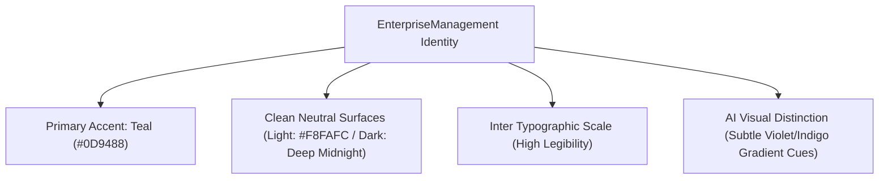

# UI/UX Design Specification: EnterpriseManagement

**Document Version:** 1.0
**Phase:** Phase 1.2 — UI/UX Design & Prototyping
**Classification:** Enterprise Design System & Visual Specification
**Status:** Approved for Implementation Planning
**Related Documents:**
- [Application-Layout-Blueprint.md](./Application-Layout-Blueprint.md)
- [Navigation-Hierarchy.md](./Navigation-Hierarchy.md)
- [Dashboard-Wireframe-Specification.md](./Dashboard-Wireframe-Specification.md)
- [Responsive-Design-Specification.md](./Responsive-Design-Specification.md)
- [Theme-Visual-Specification.md](./Theme-Visual-Specification.md)

---

## 1. Document Purpose & Scope

This specification establishes the authoritative visual and user-experience framework for the **EnterpriseManagement** platform. It defines brand identity, visual tokens, color systems, typography hierarchy, elevation, interaction paradigms, and design consistency rules.

This document serves as the single source of visual truth for engineers and designers. It bridges conceptual enterprise design with technical implementation standards across Angular 21, PrimeNG 21, and Bootstrap 5.

### Explicit Scope Boundaries
- **In Scope:** Visual token definitions, design principles, accessibility criteria, theme directions, responsive design principles, and component visual rules.
- **Out of Scope:** Concrete SCSS/CSS source code generation, UI component coding, backend database schemas, or direct manipulation of Angular configuration files.

---

## 2. Project Overview & Architectural Tenets

**EnterpriseManagement** is an AI-powered enterprise management platform designed exclusively for a **single deploying organization**.

### 2.1 Fundamental Architectural Principles
1. **Single-Organization Model:** Multi-tenancy is strictly prohibited. All enterprise modules, data structures, and views belong exclusively to the host enterprise.
2. **Exactly Ten Approved Business Modules:**
   1. Authentication & User Management
   2. Dashboard & Analytics
   3. Project Management
   4. Employee Management
   5. Task Management
   6. Invoice Management
   7. Payment Management
   8. Reports & Analytics
   9. AI Business Assistant
   10. Application Settings
3. **Exactly Five Approved Business Roles:**
   1. `Admin` — Enterprise governance, security policies, and system administration.
   2. `Manager` — Departmental operational leadership and approvals.
   3. `Employee` — Operational contributor and task execution.
   4. `Project Manager` — Project planning, milestones, and team task allocation.
   5. `Finance Manager` — Fiscal tracking, billing, invoicing, and reconciliation.
4. **Three Approved Initial AI Features:**
   1. AI Dashboard Summary
   2. AI Business Insights
   3. AI Natural Language Query
5. **Defense-in-Depth Security:** Frontend UI visibility rules are purely UX conveniences; all business mutations and sensitive data exposures are authoritatively enforced by backend policy handlers.

---

## 3. Approved Design Decisions (Phase 1.2)

The following foundational decisions have been formally approved and govern all documentation deliverables:

| Design Dimension | Approved Specification | Rationale & Enterprise Context |
|---|---|---|
| **Primary Brand Accent** | **Teal** (`#0D9488`) | Delivers a modern, crisp, professional executive presence that balances vitality and clinical precision, standing apart from generic corporate blue. |
| **Sidebar Navigation** | **Grouped Navigation** | Organizes the 10 approved modules into 6 logical business domains, minimizing cognitive load for complex operations. |
| **Dashboard Strategy** | **Common Layout for all 5 Roles** | Enforces a unified layout structure across all roles while dynamically scoping data cards, metrics, and actions based on user permissions. |
| **Authentication Layout** | **Split-Screen Layout** | Contemporary SaaS presentation featuring a high-impact branded illustration panel paired with an ergonomic form canvas. |
| **Theme Support** | **Light and Dark Themes** | Full dual-theme capability respecting OS preferences and user selection via `data-theme` attribute tokens. |
| **Iconography Standard** | **Font Awesome (Primary) / PrimeIcons (Secondary)** | Broad, versatile icon coverage for business concepts with secondary framework icons where necessary. |
| **Data Visualization** | **Direct HTML5 Canvas API (Chart.js)** | High-performance, lightweight charts with zero third-party component wrapper overhead. |

---

## 4. UI/UX Design Principles

1. **Clarity Over Novelty:** Prioritize predictable enterprise interaction patterns. Data density must remain readable, and critical operational metrics must be legible at a glance.
2. **Context-Aware Presentation:** The interface adapts to the logged-in role's scope without fragmenting the global mental model or altering core layout geometry.
3. **Ergonomic Information Hierarchy:** Vital business KPIs and system status indicators take top visual priority, supported by secondary analytical charts and tertiary tabular audit logs.
4. **Immediate & Explicit Feedback:** Every asynchronous operation provides deterministic feedback states (skeleton loaders, busy spinners, non-intrusive toast notices).
5. **Accessibility by Default:** Visual contrast, interactive target sizes, keyboard navigation, and screen-reader accessibility adhere strictly to WCAG 2.1 AA standards.

---

## 5. Brand Identity & Visual Direction

The visual identity of EnterpriseManagement communicates stability, analytical rigor, and modern intelligence.



- **Visual Tone:** Professional, minimal, decisive, and trustworthy.
- **Surface Elevation:** Clean separation between background canvas, elevated card surfaces, and overlay dialogs achieved through calibrated border outlines and subtle drop shadows rather than heavy skeuomorphic textures.

---

## 6. Color System & Design Reference Tokens

The color architecture is built around semantic enterprise tokens. All colors are specified conceptually below; runtime styles map directly to CSS custom properties.

### 6.1 Core Brand Palette (Teal Direction)

| Semantic Token | Design Reference Hex | Recommended Usage |
|---|---|---|
| `Primary Teal` | `#0D9488` | Primary call-to-action buttons, active navigation pills, brand highlights, focus rings. |
| `Primary Teal Dark` | `#0F766E` | Hover state for primary buttons, active interactive states, high-contrast dark accents. |
| `Primary Teal Light` | `#CCFBF1` | Soft badge backgrounds, hover tints on list items, active row backgrounds (Light theme). |
| `Primary Teal Muted` | `#115E59` | Dark theme active states, deep teal borders. |

### 6.2 Light Theme Surface & Neutral Palette

| Semantic Token | Design Reference Hex | Purpose & Context |
|---|---|---|
| `Light Background (Canvas)` | `#F8FAFC` | Root application viewport canvas. Cool neutral slate preventing eye strain. |
| `Light Surface (Card)` | `#FFFFFF` | Primary content containers, cards, tables, modals, dropdown panels. |
| `Light Surface Hover` | `#F1F5F9` | Table row hover, secondary button hover, interactive list highlights. |
| `Light Border Default` | `#E2E8F0` | Structural card borders, input field borders, table dividers. |
| `Light Border Subtle` | `#F1F5F9` | Secondary dividers, nested section borders. |
| `Light Text Primary` | `#0F172A` | Primary headings, KPI figures, table cell data, form labels. |
| `Light Text Secondary` | `#475569` | Subtitles, helper text, breadcrumbs, table headers. |
| `Light Text Muted` | `#94A3B8` | Input placeholders, disabled text, metadata timestamps. |

### 6.3 Dark Theme Surface & Neutral Palette

| Semantic Token | Design Reference Hex | Purpose & Context |
|---|---|---|
| `Dark Background (Canvas)` | `#0B132B` | Deep midnight navy canvas providing high-contrast depth. |
| `Dark Surface (Card)` | `#111C44` | Elevated slate/navy card surface for content widgets and modals. |
| `Dark Surface Hover` | `#1E293B` | Interactive row hover, secondary button hover in dark mode. |
| `Dark Border Default` | `#1E293B` | Card outlines, input borders, structural dividers. |
| `Dark Border Subtle` | `#162038` | Subtle interior dividers within dark cards. |
| `Dark Text Primary` | `#F8FAFC` | High-contrast white/slate for primary headings and data. |
| `Dark Text Secondary` | `#CBD5E1` | Readable secondary labels and table column headers. |
| `Dark Text Muted` | `#64748B` | Placeholders, inactive icons, timestamps. |

### 6.4 Semantic Status & Feedback Palette

Status colors maintain visual consistency across both Light and Dark themes:

| Status Token | Reference Hex | Meaning in Enterprise Context |
|---|---|---|
| `Success` | `#10B981` | Paid invoices, completed tasks, healthy project velocity, positive KPI delta. |
| `Warning` | `#F59E0B` | Invoices awaiting payment, approaching project deadlines, resource capacity warnings. |
| `Error / Danger` | `#EF4444` | Overdue invoices, blocked tasks, failed authentications, destructive actions. |
| `Info` | `#3B82F6` | Informational announcements, scheduled events, system status notes. |

---

## 7. Typography System

The typography scale utilizes **Inter** (with system sans-serif fallback) to ensure exceptional legibility at both high data densities and executive display sizes.

| Role | Font Size | Font Weight | Line Height | Tracking | Recommended Usage |
|---|---|---|---|---|---|
| **Display / Hero KPI** | `32px (2.0rem)` | Semi-Bold (`600`) | `1.2` | `-0.02em` | Primary KPI metrics on dashboard cards. |
| **Heading 1 (Page Title)** | `24px (1.5rem)` | Semi-Bold (`600`) | `1.3` | `-0.01em` | Screen titles, modal major headings. |
| **Heading 2 (Card Title)** | `18px (1.125rem)` | Medium (`500`) | `1.4` | `0` | Section headings, widget titles. |
| **Heading 3 (Subhead)** | `16px (1.0rem)` | Medium (`500`) | `1.4` | `0` | Sub-section labels, grouped list titles. |
| **Body Regular** | `14px (0.875rem)` | Regular (`400`) | `1.5` | `0` | Standard UI text, table cells, form labels. |
| **Body Small / Caption** | `12px (0.75rem)` | Regular (`400`) | `1.4` | `+0.01em` | Timestamps, helper notes, micro badges. |
| **Monospace Figures** | `14px (0.875rem)` | Regular / Medium | `1.4` | `0` | Currency amounts, invoice numbers, codes. |

---

## 8. Spacing & Baseline Grid

The spacing system is strictly anchored to an **8px baseline grid** with a `4px` half-step for micro-alignments:

```text
4px   (0.25rem) — Micro gap: Tag padding, icon-to-text micro gap.
8px   (0.50rem) — Tight gap: Button internal padding, form input inline spacing.
12px  (0.75rem) — Compact gap: Stacked form elements, compact list items.
16px  (1.00rem) — Standard gap: Card internal body padding, grid column gutters.
20px  (1.25rem) — Medium gap: Section divider spacing, widget headers.
24px  (1.50rem) — Relaxed gap: Major dashboard widget separation, page canvas padding.
32px  (2.00rem) — Generous gap: Page header to content separation.
40px  (2.50rem) — Hero separation: Major module layout divisions.
```

---

## 9. Borders, Radius, Shadows & Elevation

### 9.1 Corner Radii Hierarchy
- **Small (`4px`)**: Checkboxes, tooltips, nested status tags.
- **Medium (`6px`)**: Action buttons, text inputs, dropdown triggers, pagination items.
- **Large (`8px` to `12px`)**: Modal dialogs, floating dropdown menus, flyout popovers.
- **Card (`12px` to `16px`)**: Metric KPI cards, major dashboard containers, chart panels.
- **Pill (`9999px`)**: User avatars, status badges, active navigation indicators.

### 9.2 Elevation & Shadows
- **Level 0 (Flat)**: Background canvas (`#F8FAFC` Light / `#0B132B` Dark).
- **Level 1 (Card Surface)**: Standard content cards (`0 1px 3px rgba(0,0,0,0.05)` with `1px solid var(--border)`).
- **Level 2 (Hover & Popover)**: Hovered cards, dropdown menus (`0 4px 6px -1px rgba(0,0,0,0.07)`).
- **Level 3 (Modal & Drawer)**: Dialog windows, mobile sidebar drawers (`0 20px 25px -5px rgba(0,0,0,0.15)`).

---

## 10. Iconography Standard

- **Primary Library:** **Font Awesome Free (Solid)** (`fas fa-*`) used across main application menus, action buttons, table row actions, and status indicators.
- **Secondary Library:** **PrimeIcons** (`pi pi-*`) used specifically where integrated directly into PrimeNG core widgets (e.g., paginators, sort indicators, modal close triggers).
- **Icon Sizing:**
  - Standard action icon: `16px` (`1rem`).
  - Navigation menu icon: `18px` (`1.125rem`).
  - KPI card header icon: `20px` to `24px` (`1.25rem` to `1.5rem`).

---

## 11. Reusable Component Design Principles

1. **PrimeNG Form Controls:** Inputs, selects, and checkboxes follow the teal focus ring (`#0D9488` with `0 0 0 2px rgba(13, 148, 136, 0.2)`).
2. **Buttons Hierarchy:**
   - *Primary:* Solid Teal background with high-contrast white text.
   - *Secondary:* Outlined Teal border with transparent background.
   - *Tertiary / Ghost:* Borderless with subtle hover background tint.
   - *Danger:* Solid Crimson (`#EF4444`) reserved strictly for destructive operations.
3. **Data Tables (`p-table`):**
   - High-density rows (`44px` height) with vertical alignment.
   - Distinct, shaded column headers (`#F1F5F9` Light / `#162038` Dark).
   - Clear zebra striping or bottom-border dividers.
   - Paginator integrated seamlessly into the card footer.
4. **AI Features Visual Indicator:**
   - To distinguish AI-generated content (e.g., AI Dashboard Summary, AI Business Insights) from deterministic enterprise accounting data, AI widgets carry a distinct micro badge (`AI Generated`) and an elegant, subtle violet/teal accent gradient outline. Detailed functional behaviors (briefing length, anomaly detection rules, query formatting) are proposed functional behavior subject to Phase 7 technical finalization.

---

## 12. Accessibility Requirements (WCAG 2.1 AA)

- **Contrast Ratios:** Minimum contrast ratio of `4.5:1` for normal body text and `3:1` for large headings, graphical elements, and form borders.
- **Focus Indicators:** Visible, high-contrast 2px focus ring on all keyboard-navigable elements.
- **Color Independence:** Color is never used as the sole indicator of state; status tags combine color with descriptive text and distinct directional icons (e.g., arrow up/down, checkmark, warning triangle).
- **Screen Reader Support:** All interactive icons include descriptive `aria-label` tags, and data tables declare explicit column headers.

---

## 13. Interaction & Feedback States

- **Default:** Clean, resting state.
- **Hover:** Subtle brightness elevation (`-1px` vertical translation or surface tint shift).
- **Active / Pressed:** Visual inset or deeper tone indicating user engagement.
- **Focused:** 2px high-visibility focus ring matching brand teal.
- **Disabled:** `50%` opacity, `cursor: not-allowed`, interactive events disabled.
- **Loading:** Non-blocking skeleton loaders for cards and tables; inline spinner for action buttons.

---

## 14. Document Status & Approvals

| Item | Status | Notes |
|---|---|---|
| Teal Brand Direction | **Approved** | Primary accent `#0D9488`. |
| Split-Screen Login | **Approved** | Documented in Layout Blueprint. |
| Grouped Navigation | **Approved** | 6 groups across 10 modules. |
| Common Dashboard Layout | **Approved** | Common layout with permission-scoped views. |
| Dual Theme Architecture | **Approved** | Light and Dark specifications detailed. |
| Specific Production SCSS Mappings | *Phase 3: Frontend Foundation & Core UI Architecture* | Concrete SCSS token mappings, primary brand color updates to Teal (`#0D9488`), and component styling to be implemented in Phase 3. Phase 1.2 is strictly documentation-only. |

---

## 15. Measurement Classification & Architectural Governance

| Measurement Category | Specific Dimension / Value | Governance Classification | Verification Reference / Notes |
|---|---|---|---|
| **Breakpoint Tokens** | `xs: 0`, `sm: 576px`, `md: 768px`, `lg: 992px`, `xl: 1200px`, `xxl: 1400px` | **Verified Existing Project Configuration** | Declared in `Frontend/src/assets/styles/_variables.scss`. |
| **Container Tokens** | `540px`, `720px`, `960px`, `1140px`, `1320px` | **Verified Existing Project Configuration** | Declared in `Frontend/src/assets/styles/_variables.scss`. |
| **Spacing Scale** | `4px`, `8px`, `12px`, `16px`, `20px`, `24px`, `32px`, `40px`, `48px`, `64px` | **Verified Existing Project Configuration** | Tokens `$spacing-0` through `$spacing-10` in `_variables.scss`. |
| **Radius Scale** | `2px`, `4px`, `6px`, `8px`, `12px`, `16px`, `9999px` | **Verified Existing Project Configuration** | Tokens `$radius-xs` through `$radius-full` in `_variables.scss`. |
| **Header Height** | `64px` | **Verified Existing Project Configuration** | Declared as `--em-layout-header-height: 64px` in `_themes.scss`. |
| **Footer Height** | `48px` (with `44px` minimum) | **Verified Existing Project Configuration** | Declared as `--em-layout-footer-height: 48px` in `_themes.scss`. |
| **Expanded Sidebar Width** | `260px` | **Verified Existing Project Configuration** | Declared as `--em-layout-sidebar-width: 260px` in `_themes.scss`. |
| **PrimeNG Aura Integration**| `EnterprisePreset` | **Verified Existing Project Configuration** | Declared in `Frontend/src/app/core/theme/prime-preset.ts`. |
| **Role Architecture** | Strictly 5 approved roles | **Approved Design Decision** | Admin, Manager, Employee, Project Manager, Finance Manager. |
| **Module Scope** | Strictly 10 approved modules | **Approved Design Decision** | Mandated in `AGENTS.md` Section 2.2. |
| **AI Scope** | Strictly 3 initial AI features | **Approved Feature Scope** | AI Dashboard Summary, AI Business Insights, AI Natural Language Query. (Detailed functional behaviors: *Proposed Functional Behavior*). |
| **Brand Primary Color** | Teal (`#0D9488` Light / `#14B8A6` Dark) | **Approved Design Decision** | Approved in Phase 1.2 to replace temporary setup blue. |
| **Navigation Structure** | 6 logical groups | **Approved Design Decision** | Workspace, Organization, Projects & Work, Finance, Intelligence, Administration. |
| **Dashboard Layout** | 1 unified common layout across all 5 roles | **Approved Design Decision** | Permission-scoped widget content and metrics. |
| **Authentication Layout** | Split-screen (50/50 desktop) | **Approved Design Decision** | Left branding panel, right authentication form. |
| **Dual Theme Support** | Light and Dark modes | **Approved Design Decision** | Runtime toggle via `data-theme` attribute tokens. |
| **Touch Target Area** | Minimum `44px x 44px` | **Approved Design Decision** | WCAG 2.1 AA requirement for interactive controls. |
| **Compact Sidebar Rail** | `68px` | **Proposed Design Measurement** | Ergonomic icon rail (runtime token placeholder in `_themes.scss` is `72px`). |
| **Mobile Drawer Width** | `280px` | **Proposed Design Measurement** | Off-canvas drawer width for mobile viewports (`<768px`). |
| **Chart Heights** | Desktop `320px–360px`, Tablet `280px`, Mobile `220px–240px` | **Proposed Design Measurement** | Canvas container heights for responsive Chart.js widgets. |
| **Dialog Max-Widths** | Standard `600px`, Multi-step Wizard `900px` | **Proposed Design Measurement** | Modal geometry for PrimeNG `p-dialog` containers. |
| **Hero KPI Typography** | `32px (2.0rem)`, Semi-Bold `600` | **Proposed Design Measurement** | High-impact metric typography on dashboard KPI cards. |
| **KPI Formulas & Formulas** | Exact mathematical calculation formulas | **Pending Business Approval** | All KPI formulas require business stakeholder sign-off in Phase 6. |
| **SCSS Token Overrides** | Update `--em-color-primary` to `#0D9488` | **Pending Roadmap Confirmation** | Concrete token override scheduled for execution during Phase 3 theming implementation. |
