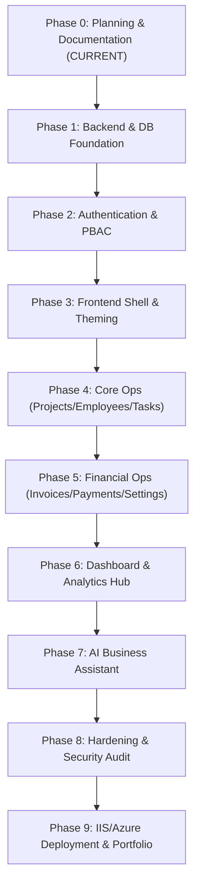

# Enterprise Implementation & Phased Development Roadmap

**Document Version**: 1.0  
**Phase**: Phase 0 — Foundation and Architecture Planning  
**Classification**: Implementation Governance Specification  
**Status**: Implementation Ready  

---

## 1. Executive Roadmap Architecture

The engineering of **EnterpriseManagement** is structured into **ten rigorous, sequential delivery phases** designed to ensure architectural integrity, zero security leakage, disciplined testing, and high-fidelity portfolio presentation.

---

## 2. Phase-by-Phase Implementation Specifications

### Phase 0: Project Foundation & Architecture Planning (CURRENT)
- **Objective**: Establish the non-negotiable architectural blueprint, threat model, functional requirements, role-permission matrices, UI design tokens, and permanent agent rules.
- **Key Deliverables**:
  - `AGENTS.md`, `README.md`, `.gitignore`.
  - Complete specifications in `Docs/Requirements/`, `Docs/Architecture/`, `Docs/Security/`, `Docs/Design/`, `Docs/Implementation/`.
- **Exit Gate**: Formal user review and sign-off. Zero application code generated.

---

### Phase 1: Backend Core Foundation & Database Architecture
- **Objective**: Scaffold the .NET 10 Clean Architecture solution, establish Entity Framework Core Code-First mappings, configure XML localization, and execute the baseline database migration.
- **Prerequisites**: Phase 0 sign-off.
- **Detailed Tasks**:
  1. Scaffold .NET 10 solution:
     - `EnterpriseManagement.Domain` (Class Library)
     - `EnterpriseManagement.Application` (Class Library)
     - `EnterpriseManagement.Infrastructure` (Class Library)
     - `EnterpriseManagement.API` (Web API)
  2. Implement Domain Entities, Value Objects, and Enums across all 10 modules.
  3. Create individual `IEntityTypeConfiguration<TEntity>` classes for every entity using Fluent API.
  4. Implement `ApplicationDbContext` with `ApplyConfigurationsFromAssembly`.
  5. Implement the ASP.NET Zero-style XML Resource Localization engine (`XmlResourceStringLocalizer`, `XmlResourceStringLocalizerFactory`) and initial XML resource files (`-en.xml`, `-es.xml`).
  6. Implement generic repository (`IRepository<T>`) and `IUnitOfWork`.
  7. Generate initial EF Core migration (`InitialCreate`) and inspect SQL script.
- **Acceptance Criteria**: Solution builds with zero warnings; database schema generates cleanly in SQL Server with strict foreign keys, indexes, and decimal precision.

---

### Phase 2: Authentication, Security & User Management
- **Objective**: Deliver complete identity, JWT authentication lifecycle, PBAC policies, account lockout, and User Management CRUD endpoints.
- **Prerequisites**: Phase 1 completed.
- **Detailed Tasks**:
  1. Configure ASP.NET Core Identity with custom `User` and `Role` entities.
  2. Implement JWT token generation service (15-min access token, claims composition).
  3. Implement Refresh Token rotation service with family tracking and reuse detection.
  4. Implement custom `PermissionAuthorizationHandler` and register PBAC policies for all 5 roles.
  5. Implement FluentValidation pipeline for authentication DTOs with localized messages.
  6. Implement RateLimiter middleware on `/api/v1/auth/*` and brute-force lockout logic.
  7. Implement API controllers: `AuthController`, `UsersController`, `RolesController`.
- **Acceptance Criteria**: Full token lifecycle functional via Swagger; unauthorized and locked accounts handled with RFC 7807 responses.

---

### Phase 3: Frontend Foundation & Core UI Architecture
- **Objective**: Scaffold the Angular 21 Standalone application, integrate PrimeNG modern theming, configure Bootstrap grid utilities, and build the enterprise layout shell.
- **Prerequisites**: Phase 2 completed.
- **Detailed Tasks**:
  1. Scaffold Angular 21 project with standalone components and strict TypeScript mode.
  2. Install and configure PrimeNG with custom design tokens matching `Docs/Design/Design-System.md`.
  3. Import scoped Bootstrap 5 grid and flex utilities.
  4. Implement `ThemeService` supporting seamless switching between **Light** and **Dark** themes.
  5. Implement `CoreModule` services: `AuthService`, `JwtInterceptor`, `ErrorInterceptor`, `LocalizationInterceptor`.
  6. Build the responsive application shell:
     - Collapsible Sidebar navigation with active route highlights.
     - Top Header bar (search omnibox, language selector, notification bell, profile menu, theme toggle).
     - Page canvas container.
  7. Implement Angular Route Guards (`authGuard`, `permissionGuard`) and `*appHasPermission` directive.
- **Acceptance Criteria**: Clean UI shell rendering flawlessly in both Light and Dark themes across desktop, tablet, and mobile viewports.

---

### Phase 4: Core Business Modules (Projects, Employees, Tasks)
- **Objective**: Build end-to-end backend services, API controllers, and Angular views for Project Management, Employee Management, and Task Management.
- **Prerequisites**: Phase 3 completed.
- **Detailed Tasks**:
  1. Implement `ProjectService`, `EmployeeService`, `TaskService` with FluentValidation.
  2. Implement Resource-Level Authorization (ownership and department checks).
  3. Build Angular UI for Project Management:
     - Projects table with progress bars and status tags.
     - Project detail view with milestone timeline and member avatar stacks.
     - Create/Edit Project modal dialog.
  4. Build Angular UI for Employee Management:
     - Employee directory with search, skill tags, and department filters.
     - Employee profile modal.
  5. Build Angular UI for Task Management:
     - Dual-view Task Board (Kanban drag-and-drop & list view).
     - Task detail modal with time logging and comment thread.
- **Acceptance Criteria**: Full CRUD and status workflows functioning with backend authorization enforcement and localized feedback toasts.

---

### Phase 5: Financial Operations & Settings (Invoices, Payments, Settings)
- **Objective**: Deliver Invoice Management, Payment Management, and Application Settings modules.
- **Prerequisites**: Phase 4 completed.
- **Detailed Tasks**:
  1. Implement `InvoiceService` with line-item arithmetic (`decimal(18,2)`), tax, and status transitions.
  2. Implement `PaymentService` with automatic invoice balance reconciliation and voiding audit.
  3. Implement `SettingsService` for organizational metadata and audit log querying.
  4. Build Angular UI for Invoices:
     - Invoices table with aging brackets and status tags.
     - Invoice creation form with dynamic line items and auto-calculating totals.
     - Printable / PDF invoice document preview.
  5. Build Angular UI for Payments:
     - Payment recording modal and transaction history table.
  6. Build Angular UI for Application Settings:
     - Organization profile form, culture preference picker, audit log viewer.
- **Acceptance Criteria**: Financial calculations accurate to the cent; balance due reconciles upon payment; immutable invoice lifecycle enforced.

---

### Phase 6: Analytics, Reporting & Dashboard Visualizations
- **Objective**: Deliver the executive Dashboard & Analytics and comprehensive Reports & Analytics modules.
- **Prerequisites**: Phase 5 completed.
- **Detailed Tasks**:
  1. Implement `DashboardService` and `ReportService` delivering aggregated operational metrics.
  2. Implement Chart.js integration via PrimeNG `p-chart` styled with Light and Dark design tokens.
  3. Build Executive Dashboard (`SCR-DASH-01`):
     - Top row KPI cards matching `dashboard-light-reference.jpg` (Revenue, Burn, Projects, Utilization).
     - Multi-series revenue line chart with time period selectors (`Yearly`, `Monthly`).
     - Growth engine mini-widgets (Finance, Project Ops, Staffing).
     - Real-time risk and alert feed widget.
  4. Build Reports Hub (`SCR-REP-01`):
     - Financial performance reports, project budget variance reports, employee productivity tables.
     - Excel (`.xlsx`) and CSV export generation.
- **Acceptance Criteria**: Dashboard renders real-time aggregated metrics with interactive charts matching the approved design reference aesthetics.

---

### Phase 7: AI Business Assistant Integration & Guardrails
- **Objective**: Integrate server-side OpenAI capabilities for executive briefings, trend insights, and natural language business querying under strict zero-trust guardrails.
- **Prerequisites**: Phase 6 completed.
- **Detailed Tasks**:
  1. Evaluate and finalize RAG (Retrieval-Augmented Generation) architecture, vector database selection, embedding strategy, document indexing, and retrieval pipeline.
  2. Implement `OpenAiClientService` in `EnterpriseManagement.Infrastructure` using server-side credentials from User Secrets / Azure Key Vault (zero client exposure).
  3. Implement deterministic backend data aggregators that fetch permission-scoped business summaries (strictly zero direct database access for AI).
  4. Implement sensitive data protection filters to scrub PII and mask individual compensation/banking details.
  5. Implement the 3 approved AI features:
     - `AI Dashboard Summary`: Executive operational and financial digest.
     - `AI Business Insights`: Proactive bottleneck and cashflow warning detection.
     - `AI Natural Language Query`: Conversational query interface with JSON Schema output validation and XML prompt delimiters.
  6. Implement AI rate limiting (10 req/min per user), usage tracking, and token cost auditing in `AiUsageLog`.
  7. Implement resilient error handling via Polly (retry with jitter, circuit breaker) and localized fallback messages via `IStringLocalizer`.
  8. Build Angular AI Workspace (`SCR-AI-01`):
     - AI briefing card on dashboard (`SCR-DASH-01`).
     - Interactive query chat interface with typing indicators and formatted insight cards.
- **Acceptance Criteria**: AI features operate strictly server-side with zero direct database connectivity; output validates against schema; token consumption is audited; RAG evaluation is completed and documented.

---

### Phase 8: Hardening, End-to-End Testing & Security Audit
- **Objective**: Execute end-to-end integration testing, security penetration testing, CORS verification, and performance profiling.
- **Prerequisites**: Phase 7 completed.
- **Detailed Tasks**:
  1. Execute unit and integration tests across all Application services and API controllers.
  2. Verify CORS policies: confirm rejection of unauthorized origins and correct preflight caching.
  3. Validate rate limiting and account lockout under simulated high-frequency requests.
  4. Conduct OWASP Top 10 security audit (SQL injection, XSS, CSRF, sensitive data exposure).
  5. Validate complete localization coverage: verify that all XML keys resolve across English, Spanish, French, German, and Arabic.
- **Acceptance Criteria**: 100% test pass rate; zero critical security vulnerabilities; sub-200ms average API response time.

---

### Phase 9: Deployment, Hosting & Portfolio Presentation
- **Objective**: Configure Microsoft IIS and Azure deployment pipelines, generate comprehensive seed data, and assemble Upwork portfolio presentation assets.
- **Prerequisites**: Phase 8 completed.
- **Detailed Tasks**:
  1. Configure Microsoft IIS hosting: `web.config` reverse proxy, URL rewrite, application pool settings.
  2. Configure Azure deployment option: Azure App Service (Linux/.NET 10), Azure SQL Database, Key Vault integration.
  3. Implement comprehensive enterprise seed script populating realistic projects, employees, tasks, invoices, and payment histories.
  4. Capture high-resolution screenshots and video demonstrations highlighting Light and Dark themes, Clean Architecture structure, and AI capabilities.
  5. Author Upwork portfolio case study documentation.
- **Acceptance Criteria**: Live application deployed and accessible; comprehensive demonstration dataset available for showcase.

