# Project Charter: EnterpriseManagement

**Document Version**: 1.0  
**Phase**: Phase 0 — Foundation and Architecture Planning  
**Classification**: Enterprise Software Specification  
**Status**: Implementation Ready  

---

## 1. Executive Summary & Vision

**EnterpriseManagement** is an enterprise-class SaaS-style business operations platform engineered specifically as a flagship portfolio demonstration for Upwork enterprise clients. The application showcases how a modern, production-grade business management system is designed, architected, secured, and scaled using enterprise-standard Microsoft and Google web technologies.

The platform unifies critical enterprise workflows—project portfolio tracking, human resource records, team task management, invoicing, payment tracking, and executive analytics—augmented by server-side generative artificial intelligence powered by the OpenAI API.

### Vision Statement
> *"To provide a robust, maintainable, single-organization enterprise operations platform that exemplifies clean software architecture, zero-trust security principles, state-of-the-art Angular standalone frontend engineering, and responsible, controlled enterprise AI integration."*

---

## 2. Business Objectives & Success Criteria

### 2.1 Primary Business Objectives
1. **Upwork Portfolio Excellence**: Establish a gold-standard reference project demonstrating mastery in .NET 10 Clean Architecture, Angular 21, PrimeNG, secure database lifecycle, and generative AI.
2. **Real-World Operational Fidelity**: Deliver an application that models real-world corporate workflows (invoicing lifecycles, project milestones, permission matrices, audit trails) rather than a trivial toy demo.
3. **High Security Standards**: Enforce defense-in-depth principles (JWT lifecycle, PBAC, CORS, rate limiting, data encryption, OWASP Top 10 mitigation).
4. **Maintainability & Extensibility**: Ensure clear separation of concerns, testability, and strict adherence to SOLID design principles without over-engineering.

### 2.2 Success Metrics
- **Architectural Purity**: 100% adherence to Clean Architecture layers with strict dependency flow (`API` -> `Infrastructure` -> `Application` -> `Domain`).
- **Zero CQRS Overhead**: Simplified, maintainable data access using traditional Repository and Service patterns with EF Core.
- **Strict Single-Organization Focus**: No leaking multi-tenant abstractions or complexity.
- **Zero Security Credential Leaks**: Zero client-side API keys or connection strings; OpenAI calls proxied 100% through authenticated backend controllers.
- **Multilingual Readiness**: 100% of user-facing messages and validation rules localized via ASP.NET Zero-style XML resource files (`.xml`).
- **Responsive Dual-Theme UI**: Flawless visual fidelity across Desktop, Tablet, and Mobile in both Light and Dark modes.

---

## 3. System Scope & Boundaries

### 3.1 Single-Organization Mandate
The application is designed strictly for a **Single Organization**. It is **NOT a multi-tenant platform**.
- **No `TenantId` partitioning**: All departments, employees, projects, and invoices exist within the unified boundary of the single deploying enterprise.
- **No tenant onboarding workflows or tenant-resolution middleware**: Eliminates unnecessary cognitive overhead, cross-tenant data leak vectors, and redundant infrastructure complexity.

### 3.2 Approved Application Modules (Strictly 10)
The platform is bound to exactly the following ten approved modules. No module may be added, removed, renamed, or merged:
1. **Authentication & User Management**
2. **Dashboard & Analytics**
3. **Project Management**
4. **Employee Management**
5. **Task Management**
6. **Invoice Management**
7. **Payment Management**
8. **Reports & Analytics**
9. **AI Business Assistant**
10. **Application Settings**

### 3.3 Approved User Roles (Strictly 5)
Access control is restricted to exactly five predefined business roles:
1. **Admin**
2. **Manager**
3. **Employee**
4. **Project Manager**
5. **Finance Manager**

### 3.4 Approved AI Scope & Security Directives (Strictly 3 Initial Features)
The generative AI capabilities are strictly server-side and limited to:
1. **AI Dashboard Summary**: Executive textual briefing synthesizing organizational health, delivery velocity, and financial KPIs.
2. **AI Business Insights**: Proactive trend detection and risk analysis across project deliveries, revenue, and receivables.
3. **AI Natural Language Query**: Conversational inquiry enabling authorized managers to query pre-aggregated business summaries using natural language.

#### Non-Negotiable AI Guardrails
- **API Key Security**: The OpenAI API key is stored strictly server-side (User Secrets in development; Azure Key Vault in production) and never exposed to the Angular client.
- **Backend-Controlled Data Retrieval**: AI is never granted direct database access or raw connection strings. Deterministic C# queries fetch data.
- **Authorization Gating**: User identity, PBAC claims, and resource-level authorization are verified prior to data retrieval.
- **Output Validation**: Responses must adhere to OpenAI Structured Outputs (JSON Schema) and prompt injection delimiters.
- **Sensitive Data Protection**: PII is scrubbed, and individual salaries and banking details are masked before prompt formatting.
- **Usage Logging & Rate Limiting**: Token consumption, latency, and costs are logged in `AiUsageLog`; calls are rate-limited to 10 req/min per user.
- **Resilient Error Handling**: Transient failures are mitigated via Polly retries and circuit breakers, falling back to localized messages without disrupting application workflows.
- **RAG Architecture Decision Requirement**: Retrieval-Augmented Generation (RAG) architecture, vector database selection, embedding strategy, document indexing, and retrieval pipeline **must be evaluated and finalized during the dedicated AI Development Phase (Phase 7)**. In strict accordance with Phase 0 governance, do not implement RAG or select additional AI infrastructure during Phase 0.

---

## 4. In-Scope vs. Out-of-Scope Matrix

| Category | In-Scope (Phase 0 - 9) | Out-of-Scope (Prohibited) |
|---|---|---|
| **Tenancy** | Single Organization, single enterprise database | Multi-tenancy, multi-database per tenant, tenant switching |
| **Backend Patterns** | Traditional Service + Repository pattern, Unit of Work, FluentValidation | CQRS, MediatR, Event Sourcing, Event-driven message buses |
| **Database Schema** | EF Core Code-First, EF Migrations, `IEntityTypeConfiguration<T>` per entity | Manual SQL scripts outside migrations, auto-generated migrations without review |
| **Localization** | XML-based `.xml` resource localization (ASP.NET Zero style), `IStringLocalizer` | Binary `.resx` resource files, database-stored dynamic localization strings |
| **Frontend** | Angular 21 Standalone Components, PrimeNG, Bootstrap Grid/Flex, Chart.js | Angular NgModules, custom component duplication where PrimeNG fits |
| **Theming** | Light and Dark enterprise themes matching approved design references | Unstyled raw browser components, hardcoded inline CSS colors |
| **AI Integration** | Server-side OpenAI proxying, pre-aggregated JSON context, structured output | Direct Angular OpenAI calls, client-side API keys, direct AI SQL database access |
| **Deployment** | Microsoft IIS on Windows Server, Azure App Service & Azure SQL Database | Linux Docker containers (optional future consideration, not primary) |

---

## 5. Stakeholders & Governance

| Role | Responsibility |
|---|---|
| **Solution Architect** | Overall system design, Clean Architecture enforcement, ADR authoring, integration governance. |
| **Technical Lead** | Code quality standards, API contract definitions, EF Core data modeling, PR review. |
| **Security Architect** | Threat modeling, JWT security, CORS configuration, rate limiting, OWASP mitigation. |
| **Frontend Lead** | Angular 21 architecture, PrimeNG theme customization, responsive layouts, accessibility. |
| **Client / Upwork Reviewer**| Final acceptance of portfolio deliverables, functional evaluation, code review. |

---

## 6. Assumptions & Technical Constraints

### 6.1 Assumptions
1. The client organization deploys the application on a dedicated infrastructure instance (IIS or Azure).
2. Users access the application via modern standards-compliant web browsers (Chrome, Edge, Firefox, Safari).
3. The OpenAI API endpoint is reachable via HTTPS from the hosting backend server.
4. Relational data volume is well within standard Microsoft SQL Server enterprise scalability thresholds.

### 6.2 Constraints
1. **No Code Generation in Phase 0**: Architecture and planning documentation must be complete and approved prior to any scaffolding.
2. **Zero Client Secrets**: Secrets must reside exclusively in server-side configuration mechanisms (Azure Key Vault / ASP.NET User Secrets).
3. **No CQRS**: Simplicity and maintainability are prioritized over distributed messaging patterns.
4. **XML Localization**: Localization strings must be strictly file-based XML adhering to the ASP.NET Zero schema.

---

## 7. Risk Management Matrix

| Risk ID | Risk Description | Severity | Likelihood | Mitigation Strategy |
|---|---|---|---|---|
| **RSK-01** | Accidental exposure of OpenAI API credentials | Critical | Low | Hard boundary: Angular has zero OpenAI knowledge; backend controller proxies all calls; keys managed in User Secrets / Azure Key Vault. |
| **RSK-02** | CSS style collisions between PrimeNG and Bootstrap | Medium | Medium | Strict encapsulation: Bootstrap is imported exclusively for grid (`container`, `row`, `col`) and flex utilities (`d-flex`, `gap-*`). No Bootstrap button or form CSS imported. |
| **RSK-03** | Performance degradation from unindexed EF Core queries | High | Medium | Every entity configuration file must declare explicit indexes for foreign keys, search fields, and composite lookups. |
| **RSK-04** | AI hallucination or leakage of unauthorized data | High | Low | Deterministic backend aggregators filter data based on user authorization before passing sanitized context to OpenAI; structured JSON outputs enforce schema. |
| **RSK-05** | Inconsistent localization strings or missing keys | Low | Medium | Custom XML localization engine implements fallback to default culture (English) and logs missing resource key warnings. |
| **RSK-06** | Accidental cascading deletion of critical audit or financial data | Critical | Medium | Fluent API configuration mandates `DeleteBehavior.Restrict` on all foreign key relationships across invoices, payments, and projects. |

---

## 8. Milestone Roadmap

```mermaid
flowchart LR
    P0["Phase 0: Planning & Docs"] --> P1["Phase 1: Backend Foundation"]
    P1 --> P2["Phase 2: Auth & Security"]
    P2 --> P3["Phase 3: Frontend Shell"]
    P3 --> P4["Phase 4: Core Ops (Projects/Tasks)"]
    P4 --> P5["Phase 5: Financial Ops (Invoices/Payments)"]
    P5 --> P6["Phase 6: Analytics & Reports"]
    P6 --> P7["Phase 7: AI Assistant"]
    P7 --> P8["Phase 8: Hardening & Testing"]
    P8 --> P9["Phase 9: Deployment & Showcase"]
```

---

## 9. Sign-Off & Approvals
This Project Charter serves as the definitive baseline for Phase 0. No modification to system scope, module boundaries, or technological foundations may occur without documented approval from the Technical Lead and Solution Architect.

