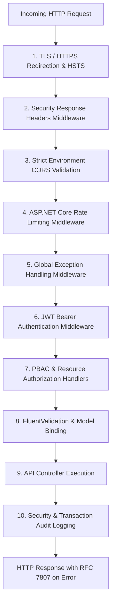
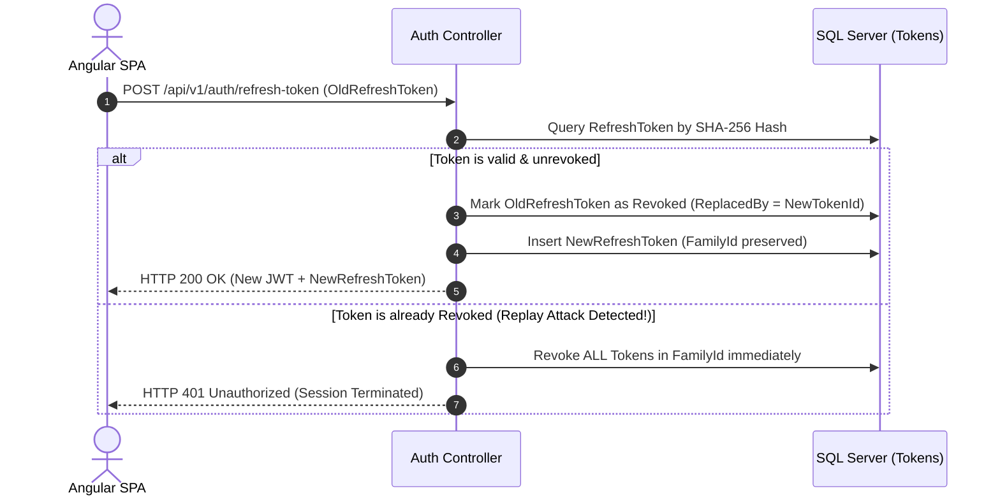

# API Security Architecture & Middleware Pipeline

**Document Version**: 1.0  
**Phase**: Phase 0 — Foundation and Architecture Planning  
**Classification**: Technical Security Specification  
**Status**: Implementation Ready  

---

## 1. Architectural Overview & Request Pipeline

The **EnterpriseManagement.API** layer establishes an enterprise-grade, defense-in-depth HTTP request pipeline where every request passes through ordered security middleware before reaching any application controller.



---

## 2. Cross-Origin Resource Sharing (CORS) Architecture

### 2.1 Critical Security Axiom
> [!WARNING]
> **CORS is NOT a security boundary or replacement for authentication and authorization.** CORS is a browser-enforced mechanism that governs cross-origin resource sharing. Backend authentication (`[Authorize]`) and permission checks (`[HasPermission]`) must independently guard every endpoint regardless of origin.

### 2.2 Environment-Driven Allowed Origins
The API strictly restricts cross-origin communication to explicitly whitelisted frontend origins configured per environment. Wildcard origins (`*`) are **strictly prohibited** in staging and production environments:

- **Development**:
  ```json
  "Cors": {
    "AllowedOrigins": [
      "http://localhost:4200",
      "https://localhost:4200"
    ]
  }
  ```
- **Staging / Production**:
  ```json
  "Cors": {
    "AllowedOrigins": [
      "https://enterprise.yourdomain.com",
      "https://app.yourdomain.com"
    ]
  }
  ```

### 2.3 Policy Directives & Credentials Handling
- **Allowed HTTP Methods**: Strictly restricted to `GET`, `POST`, `PUT`, `DELETE`, `OPTIONS`. Unused HTTP verbs (`TRACE`, `CONNECT`) are rejected at the web server layer.
- **Allowed Request Headers**: Explicitly whitelisted:
  - `Authorization` (Bearer JWT token)
  - `Content-Type` (JSON, Multi-part Form)
  - `Accept-Language` (Culture resolution)
  - `X-Requested-With`
  - `X-Correlation-Id` (Distributed tracing)
- **Exposed Response Headers**:
  - `X-Pagination` (Metadata for paged list responses)
  - `X-Correlation-Id`
- **Credentials Handling**: `AllowCredentials()` is permitted **only** when paired with explicit, non-wildcard origins.
- **Preflight Cache Management**: `SetPreflightMaxAge(TimeSpan.FromHours(1))` is configured on preflight `OPTIONS` responses to minimize redundant HTTP roundtrips.

---

## 3. JWT Authentication & Refresh Token Pipeline

### 3.1 Token Validation Parameters
The `JwtBearerHandler` is configured with strict validation parameters:
- `ValidateIssuer`: `true` (Validates against configured enterprise issuer).
- `ValidateAudience`: `true` (Validates against configured API audience).
- `ValidateLifetime`: `true` (Enforces token expiration).
- `ValidateIssuerSigningKey`: `true` (Verifies signature using the server secret key).
- `ClockSkew`: `TimeSpan.Zero` (Zero tolerance for expired tokens).
- `RequireSignedTokens`: `true`.

### 3.2 Token Refresh & Reuse Detection Architecture
To prevent token hijacking and replay attacks, refresh tokens operate within a strict **Token Family Rotation** lifecycle:



---

## 4. Authorization & Policy Enforcement

### 4.1 Permission-Based Authorization (PBAC)
- Custom policy definitions registered in ASP.NET Core dependency injection:
  ```csharp
  services.AddAuthorization(options =>
  {
      foreach (var permission in Permissions.GetAllPermissions())
      {
          options.AddPolicy(permission, policy =>
              policy.Requirements.Add(new PermissionRequirement(permission)));
      }
  });
  ```
- Granular permission requirement handlers evaluate user claims against the required permission string.

### 4.2 Resource-Level Authorization (RLA)
- Enforces contextual ownership at the database query layer:
  - If a user requests `/api/v1/projects/{id}`, the backend service queries the project and verifies whether the user is an `Admin`, a `ProjectLead`, or an assigned team member.
  - If unauthorized, the API returns `HTTP 403 Forbidden` without exposing whether the resource exists or leaking internal metadata.

---

## 5. Attack Prevention Implementation

### 5.1 SQL Injection Defense
- **100% Parameterized EF Core Queries**: No dynamic string concatenation in LINQ or raw queries.
- **Strict DTO Mapping**: Application services accept and return strongly-typed DTOs; raw entities are never bound directly from HTTP request bodies.

### 5.2 Rate Limiting Middleware Configuration
The API leverages the built-in ASP.NET Core RateLimiter configured with custom partitioning:

```csharp
builder.Services.AddRateLimiter(options =>
{
    // Global rate limiter
    options.GlobalLimiter = PartitionedRateLimiter.Create<HttpContext, string>(context =>
        RateLimitPartition.GetSlidingWindowLimiter(
            partitionKey: context.Connection.RemoteIpAddress?.ToString() ?? "anonymous",
            factory: partition => new SlidingWindowRateLimiterOptions
            {
                PermitLimit = 100,
                Window = TimeSpan.FromMinutes(1),
                SegmentsPerWindow = 6,
                QueueLimit = 0
            }));

    // Authentication rate limiter (prevent brute force)
    options.AddPolicy("AuthLimiter", context =>
        RateLimitPartition.GetFixedWindowLimiter(
            partitionKey: context.Connection.RemoteIpAddress?.ToString() ?? "anonymous",
            factory: partition => new FixedWindowRateLimiterOptions
            {
                PermitLimit = 10,
                Window = TimeSpan.FromMinutes(1)
            }));

    // AI Endpoint rate limiter (prevent quota exhaustion)
    options.AddPolicy("AiLimiter", context =>
        RateLimitPartition.GetFixedWindowLimiter(
            partitionKey: context.User.FindFirst(ClaimTypes.NameIdentifier)?.Value ?? "anonymous",
            factory: partition => new FixedWindowRateLimiterOptions
            {
                PermitLimit = 10,
                Window = TimeSpan.FromMinutes(1)
            }));
});
```

### 5.3 Request Size & Secure File Uploads
- Global request body size limit set to **10 MB** in Kestrel server options.
- Upload endpoints capped at **25 MB**.
- Binary file upload validation performs three-point verification:
  1. Whitelisted file extensions (`.pdf`, `.jpg`, `.png`, `.xlsx`, `.docx`).
  2. Whitelisted MIME types.
  3. Binary magic-byte signature check before persisting to disk or blob storage.

---

## 6. AI Endpoint Security & Server-Side Proxying

### 6.1 Server-Side Proxy Architecture
Direct communication between Angular and OpenAI is strictly prohibited. The API acts as an authenticated security gateway for the **three approved AI capabilities**:
1. *AI Dashboard Summary* (`/api/v1/ai/summary`)
2. *AI Business Insights* (`/api/v1/ai/insights`)
3. *AI Natural Language Query* (`/api/v1/ai/query`)

```mermaid
flowchart LR
    ANG["Angular Client (No Keys)"] -->|JWT Bearer| GW["EnterpriseManagement.API Gateway"]
    GW -->|1. PBAC & RLA Check| AUTH["Authorization Pipeline"]
    AUTH -->|2. Deterministic C# Query| DB[("SQL Server (EF Core)")]
    DB -->|3. Entities| SAN["Data Sanitizer (Mask PII/Pay)"]
    SAN -->|4. Sanitized Context| PROMPT["Prompt Sandbox (XML Delimiters)"]
    PROMPT -->|5. TLS 1.3 / JSON Schema| OAI["OpenAI API (Server Key)"]
    OAI -->|6. Structured JSON| VAL["Output Schema Validator"]
    VAL -->|7. Audit Log| LOG[("AiUsageLog")]
    VAL -->|8. Clean DTO| ANG
```



### 6.2 Key Security & Credential Isolation
- OpenAI credentials reside exclusively in server-side configuration (ASP.NET Core User Secrets in development; Azure Key Vault in staging/production).
- Angular has zero knowledge of the OpenAI API key, endpoints, or network requests.
- No OpenAI credentials or raw external headers/payloads are ever returned to the client.

### 6.3 Backend-Controlled Data Retrieval & Authorization
- **Zero Direct Database Access**: The OpenAI API is **never granted direct database access**, connection strings, or raw SQL capabilities. AI services consume only pre-aggregated, sanitized DTO context assembled by deterministic C# repository queries.
- **Pre-Retrieval Authorization Enforcement**: The API validates JWT authentication and checks granular PBAC claims (`AI.DashboardSummary`, `AI.BusinessInsights`, `AI.NaturalLanguageQuery`) alongside Resource-Level Authorization (RLA) before querying data. Users cannot query or receive insights derived from data outside their authorized scope.

### 6.4 Sensitive Data Protection & Prompt Injection Defense
- **Sensitive Data Masking**: Context builders strip Personally Identifiable Information (PII) and mask employee salaries and bank routing numbers prior to prompt formation.
- **Prompt Injection Sandboxing**: User inputs in natural language queries are sanitized, stripped of control characters, and enclosed in strict XML delimiter tags (`<user_query>...</user_query>`) within system prompt templates to prevent prompt jailbreaking.
- **Structured Outputs (JSON Schema)**: All OpenAI API requests mandate strict JSON Schema enforcement (`response_format: { type: "json_schema" }`). Responses failing schema validation are rejected.

### 6.5 Usage Logging & Resilient Error Handling
- **Audit Persistence (`AiUsageLog`)**: Every AI invocation records `UserId`, `FeatureName`, `ModelName`, `PromptTokens`, `CompletionTokens`, `TotalTokens`, `LatencyMs`, `Timestamp`, and `EstimatedCost`.
- **Rate Limiting**: Enforced via ASP.NET Core RateLimiter policy (`AiLimiter`): Maximum **10 requests per minute per authenticated user**.
- **Resilient Error Handling**: Outgoing HTTP calls to OpenAI utilize Polly retry policies (3 retries with exponential backoff and jitter) and circuit breakers. Failures return localized fallback messages via `IStringLocalizer` without crashing the application.
- **RAG Architecture Decision Requirement**: Retrieval-Augmented Generation (RAG) architecture, vector database selection, embedding strategy, document indexing, and retrieval pipeline **must be evaluated and finalized during the dedicated AI Development Phase (Phase 7)**. In strict accordance with Phase 0 governance, RAG infrastructure is not implemented or selected during Phase 0.

---

## 7. Global Exception Handling & RFC 7807 Problem Details

All unhandled exceptions are caught by custom global exception middleware:
- **`ValidationException`**: Returns `HTTP 400 Bad Request` with structured field errors.
- **`NotFoundException`**: Returns `HTTP 404 Not Found` with localized error description.
- **`UnauthorizedException` / `ForbiddenException`**: Returns `HTTP 401 / 403`.
- **Unhandled / Internal Exceptions**: Returns `HTTP 500 Internal Server Error` with a sanitized message and unique `TraceId`. Stack traces and SQL error details are strictly suppressed.

